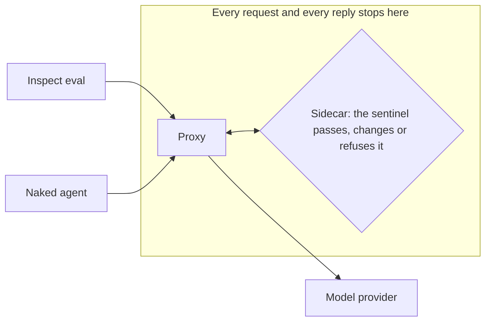
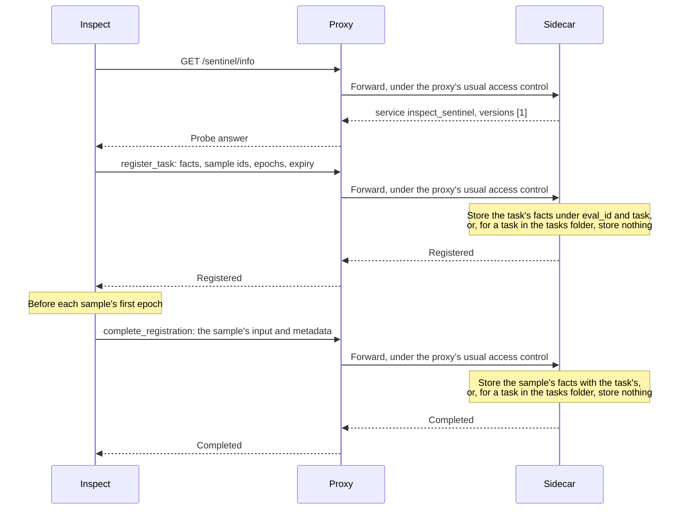
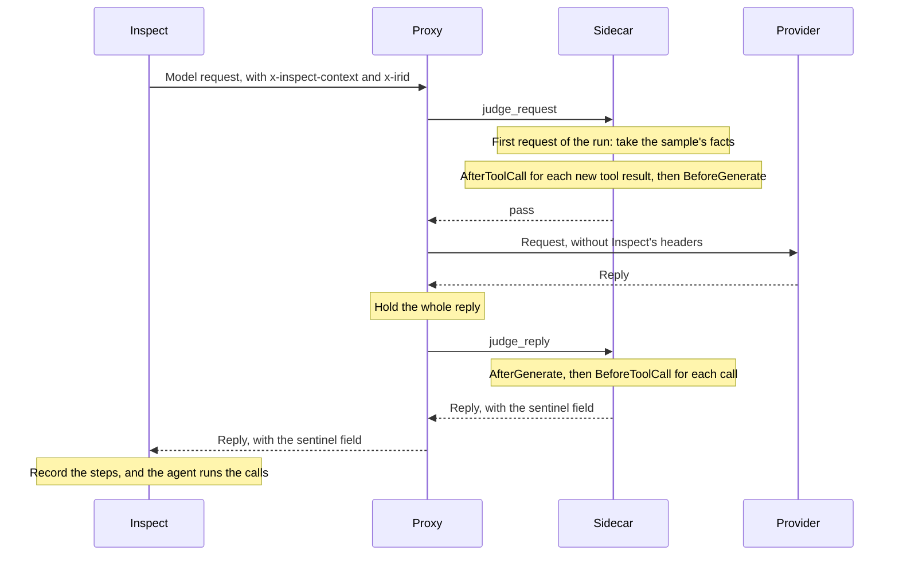
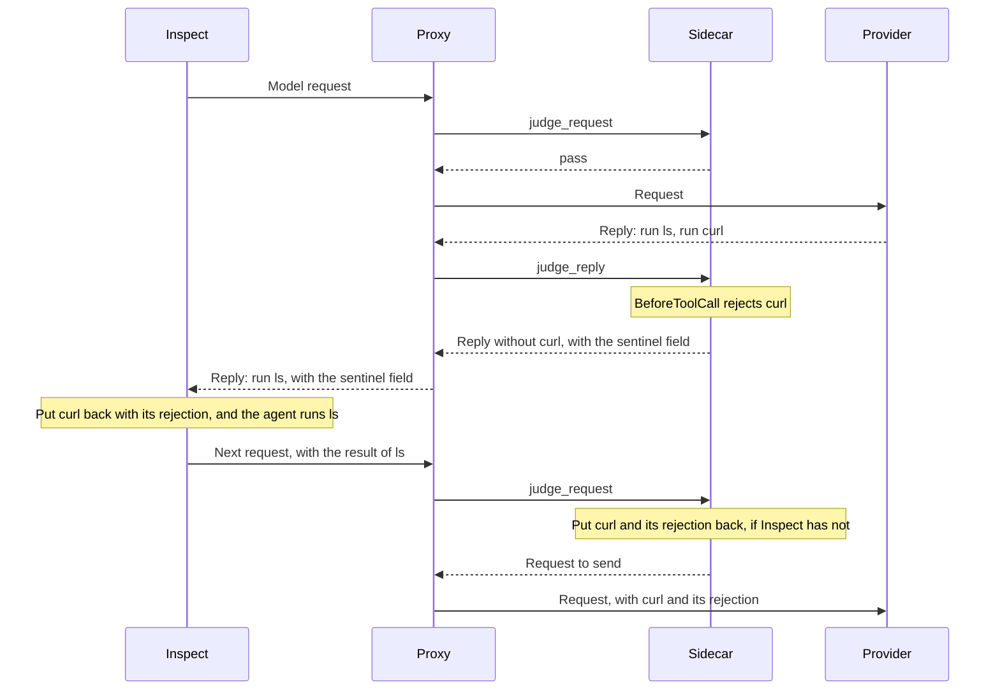
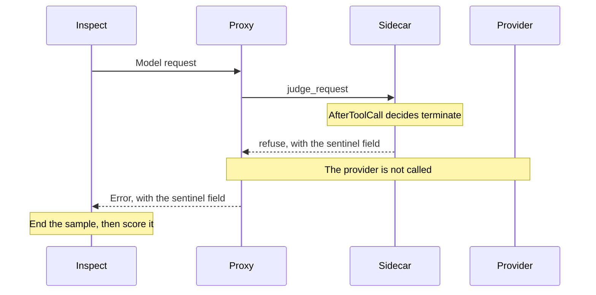
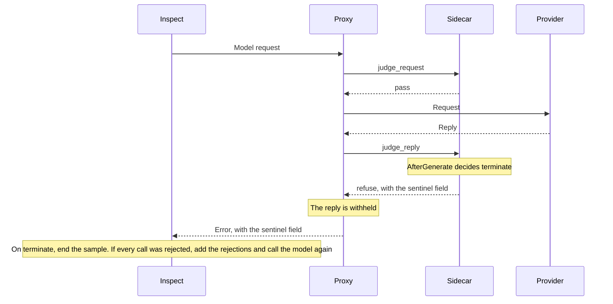
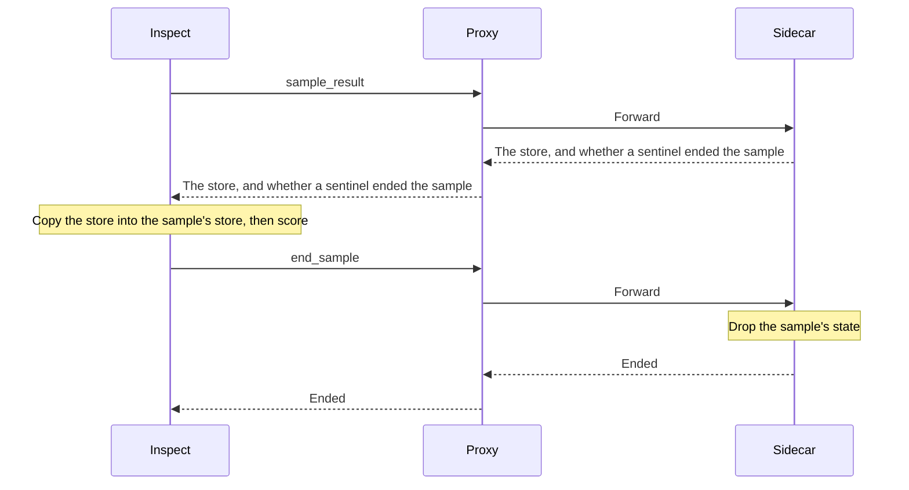
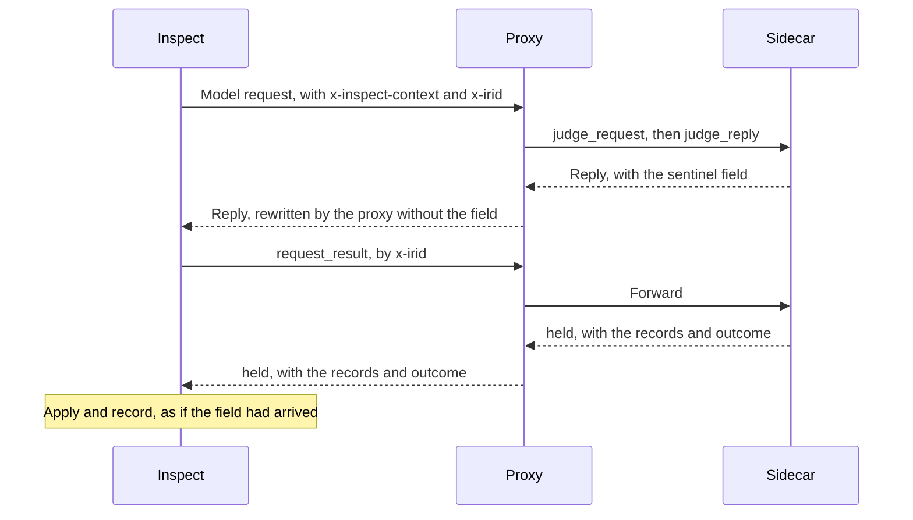
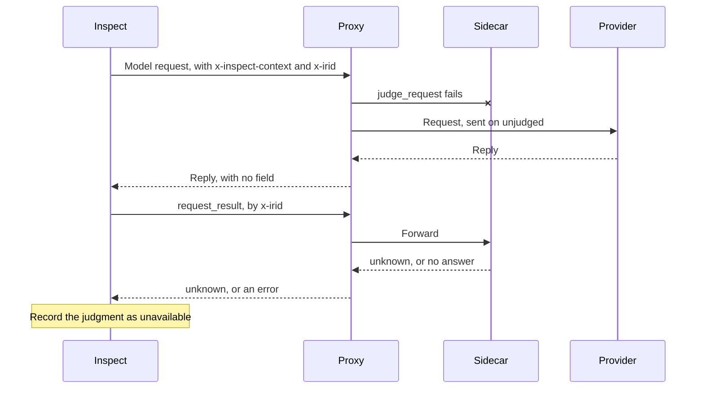
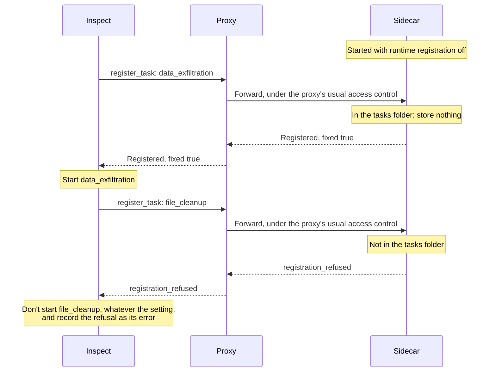

# The sidecar: a sentinel beside a model proxy

This document describes the sidecar: a Python program that runs a sentinel beside an HTTP proxy in front of a model provider's API, such as LiteLLM or Middleman. The proxy hands the sidecar each model request and each reply. The sidecar finds in them the steps a sentinel judges, including the steps before and after each tool call, runs the sentinel, and carries out each decision on the request or reply it holds. It serves agents that make their own model calls, such as Claude Code, and Inspect evals. An eval is also told what was decided, so that it records the same as when its sentinel runs in its own process.

It builds on [sentinel-deployment.md](sentinel-deployment.md). [sidecar-plan.md](sidecar-plan.md) is the plan for building it.

## Two kinds of client

The sidecar runs sentinels for two kinds of client.

- **An Inspect eval.** Inspect makes the model calls, for its own agents and for bridged ones. Inspect can tell the sentinel about the task and the sample, and it can act on what the sidecar answers.
- **A naked agent.** The agent makes the model calls itself. Examples are Claude Code in a sandbox, and any agent in deployment. The sentinel has only what is in the model traffic, and the sidecar's answer goes to a program that knows nothing about sentinels.



A naked agent needs no change to have its model traffic judged. An Inspect eval says which sample each request belongs to, registers its tasks where that is allowed, and is told what the sentinel decided, as section 9 describes. That part of Inspect is not built yet. Whoever runs the proxy chooses the sentinel.

When the sentinel runs in a sidecar, Inspect acts as its client. This integration is intended to be transparent to eval authors; its internal names and any configuration surface are for Meridian to agree. Inspect finds the sidecar, registers task facts where that is allowed, sends the request context, and reads what the sidecar decided. The sidecar runs the sentinel. It judges what it can see in the model requests and replies that pass through the proxy. It also coordinates the steps before and after each tool call, which it finds in the tool calls of a reply and the tool results of the next request.

## Words used in this document

- **Sentinel.** The monitors and protocols that watch an agent, as a task configures them with `Task(sentinel=...)` or an operator configures them for a sidecar.
- **In-process execution and Inspect's sidecar client.** Two paths by which Inspect obtains sentinel decisions. In-process execution runs the sentinel in the eval. The sidecar client reads decisions already made on the proxy's traffic and applies them in Inspect; it drives no sentinel step itself. These describe responsibilities, with internal names and structure to be agreed with Meridian. Eval authors should not need to choose a client class or change their task code to use the sidecar integration.
- **Host.** Where a sentinel runs: Inspect's process, or the sidecar. The core package's `Host` interface is narrower. It is what a sentinel calls for its side effects, such as a model call, and each host implements it. The sidecar's implementation is `SidecarHost`.
- **Step.** One thing a sentinel is asked to judge, such as a tool call the model has proposed. Each step belongs to one of four stages: before a model call, after a model call, before a tool call and after a tool call.
- **Decision.** What a sentinel says about a step: `proceed`, `reject`, `terminate`, `modify` or `escalate`.
- **Turn.** One reply from the model: its text and every tool call in it.
- **Conversation.** The list of messages that a model request carries.
- **Run.** The sidecar's word for the model calls it keeps together: one sample in one epoch, identified by the uuid the eval log gives the sample, or one session of a naked agent. It is not Inspect's run, which is one `inspect eval` command and its `run_id`. So the endpoint for evals says sample, as Inspect does, and names a sample by its uuid. A run can hold more than one conversation. A sample that Inspect retries after an error keeps its uuid, so it is the same run, but each attempt starts its state afresh (section 7).
- **Proxy hook.** Code of ours that a proxy runs, which forwards the proxy's model traffic to the sidecar. `MiddlemanHook` is one. It is not the proxy's own mechanism for running such code, which Middleman calls its passthrough hook. It is not an Inspect hook either, which is code that an eval runs.
- **Measured.** A claim marked **measured** was run and observed. Measurements are kept where they are the reason for a design choice.

## Goals

1. **One implementation of providers.** The sidecar reads and writes the formats of model providers with inspect_ai's Python code, and has no second implementation of its own. Where inspect_ai's code falls short of what a proxy needs, the gap is listed near the end of this document, under "Asked of inspect_ai", and raised with inspect_ai. The code is not forked.
2. **No in-process advantage.** A sentinel gains nothing from running in the same process as the eval. A task and its sentinel are written as if the sentinel were behind a proxy. Whatever an eval's own host gives a sentinel, the sidecar gives too, or the sidecar says that it cannot.
3. **A sidecar that is mostly independent of the proxy.** LiteLLM is supported first, followed by Envoy's shim. Middleman follows trusted run identity and Hawk/METR accepting the gateway change. What is specific to one proxy is kept out of the sidecar where it can be, in a proxy hook that the proxy runs. For a proxy that can run no code of ours, the sidecar has a thin adapter called a shim.

## 1. The shape

A request or a reply reaches the sidecar from a proxy. The handler works out what it means and what should happen to it. The sentinel runner runs the monitors and protocols.

```text
   Middleman                 LiteLLM                   Envoy
   runs a proxy hook,        runs a proxy hook,        runs no code of ours
   MiddlemanHook             LiteLLMGuardrail
        |                         |                         |
        |     JSON over HTTPS     |                  bytes over gRPC
        +------------+------------+                     (ext_proc)
                     v                                      v
            endpoint for proxies                       Envoy shim
                     |                                      |
                     +------------------+-------------------+
                                        v
                                     handler
   a request or a reply in the provider's format, read into Inspect's types
   and made into steps; which run it belongs to; what was rejected; records
   an answer: pass, replace with this, or refuse and why
                                        |
                                        v    only plain data crosses here
                                 sentinel runner
   `run_sentinel` over the configured monitors and protocols; their store; their model calls
```

- **A proxy hook** is what a proxy runs, where the proxy can load code. It turns what that proxy hands over into the sidecar's messages, sends them, and carries out the answer in that proxy's terms. It knows nothing about sentinels or about model providers. Each proxy hook is a small package of its own, under `src/proxies`. LiteLLM's is `LiteLLMGuardrail`. Middleman's is `MiddlemanHook`, which needs Middleman to have a passthrough hook (below).
- **The endpoint for proxies** is the same for every proxy hook. A proxy hook puts each request and each reply to it, and is answered with pass, replace or refuse. The endpoint for proxies uses JSON-RPC 2.0, at `POST /proxy/v1`, with the methods `judge_request` and `judge_reply`, and, for a reply handed over as it arrives, the reply-stream methods of [section 5](#handing-over-a-reply-as-it-arrives). JSON-RPC was chosen to be consistent with the endpoint for evals. The methods and their results are described by `proxy_endpoint.schema.json`, which is written from the endpoint's own models and kept beside it. A proxy hook is tested against that file.
- **A shim** is for a proxy that can run no code of ours, such as Envoy. It speaks that proxy's own protocol, inside the sidecar. Its dependencies are an optional extra, so only a deployment behind that proxy installs them. The Envoy shim is `inspect_sentinel.sidecar.envoy`, with the `envoy` extra (below).
- **The handler** is the same for every proxy. The endpoint for proxies, or a shim, gives the handler a `Request` or a `Reply`, and the handler returns one of three answers: `Pass`, `Replace` or `Refuse`. The answer says what was decided. It does not say how the proxy should carry that out, because that is the proxy hook's job, or the shim's. A `Refuse` holds what the client is told: the status, the message, the response headers and, for an Inspect client, the `sentinel` field (section 9). The proxy hook puts all of them into the error it sends the client, in the proxy's own form, and does not read them on the way. The `sentinel` field on a generate reply that goes through is put in by the handler, because a proxy hook knows nothing of provider formats and cannot put it in itself. So for an Inspect client the handler never answers a reply with `Pass`: it answers with `Replace`, whose body is the reply with the field added.
- **The sentinel runner** is the core package's `run_sentinel` function, unchanged. It runs in the sidecar's process. Only steps and decisions pass between the handler and the runner, as plain data, so the runner can be moved to a process of its own later. Reasons to move it would be throughput, keeping a sentinel that fails away from the traffic, or running beside a proxy that is not written in Python.

Two rules keep the handler from being limited to what the least capable proxy can do. First, the handler is designed around what a sentinel needs, and not around what one proxy can supply. Second, when a proxy cannot do something, its proxy hook or its shim says so, and the capability stays in the handler for the other proxies.

**Nothing of this package runs in a proxy.** A proxy runs only a proxy hook, which forwards each request and each reply to the sidecar over HTTPS, as JSON. A proxy hook does not depend on inspect_sentinel or on inspect_ai, and is installed by itself. In the other direction, a sentinel imports only the core package and never the sidecar. A test checks that importing the core package does not load the sidecar.

### What each proxy hands over

| | Middleman | LiteLLM | Envoy |
| --- | --- | --- | --- |
| where the proxy's side runs | in `MiddlemanHook`, which Middleman loads through its passthrough hook and calls after the caller has signed in | in `LiteLLMGuardrail`, which LiteLLM loads as a guardrail and calls after the caller has signed in | no code of ours; Envoy's `ext_proc` filter calls the sidecar |
| a request arrives as | parsed JSON, in the provider's format | a dictionary, already parsed, that also holds LiteLLM's own working state | raw bytes |
| a reply arrives as | the provider's bytes, decompressed, held whole | the provider's bytes where Anthropic serves a request to the Messages route; otherwise LiteLLM's own objects, or a stream of them, which the guardrail holds | raw bytes, in chunks as the provider sends them |
| to refuse | Middleman writes an error in the provider's own format | the guardrail raises an exception, and LiteLLM writes the error in the format of the route | the sidecar sends an immediate response of its own |

Middleman is to have a passthrough hook: a setting that names a class, which Middleman loads at startup. Middleman calls the class with each passthrough request before sending it to the provider. It then holds the provider's reply whole and calls the class with the reply. `MiddlemanHook` puts each one to the sidecar's endpoint for proxies, and the answer to each is pass, replace or refuse. The passthrough hook is a change to Middleman, which is Hawk's to accept. `MiddlemanHook` calls the same methods as `LiteLLMGuardrail`.

With each request, the proxy hook tells the sidecar the provider, the model's public name, the user, the headers that say which job and sample the request belongs to, and any other request headers the operator has listed for the proxy hook. No credential is sent to the sidecar: Middleman removes the caller's before it calls the proxy hook. Who can reach the sidecar is the operator's to control: the sidecar listens at an address that only Middleman can reach (section 10). An operator can also limit the proxy hook to some of Middleman's channels. A channel is the kind of caller: an eval, a scan or a direct call. Traffic on the other channels never reaches the proxy hook and streams as it does when no proxy hook is set.

**Middleman's passthrough hook and `MiddlemanHook` are two different things, with different owners.**

- **Middleman owns the passthrough hook.** That covers when a loaded class is called, the holding of a reply, how long one call may take, and what a failed call means. A class loaded through it may decide entirely in process. Middleman knows nothing of the sidecar or of its messages.
- **This package owns `MiddlemanHook`**, the messages it sends and their schema, and the endpoint that receives them.
- **A sentinel's refusal and a failure are told apart.** `MiddlemanHook` turns a refusal from the sidecar into an `HTTPException`, which Middleman answers the client with. A sidecar that can't be reached, or whose answer can't be read, is raised as a `SidecarError`. Middleman's own setting then says whether the call is refused or let through.

**LiteLLM's proxy hook is `LiteLLMGuardrail`**, a package of its own in `src/proxies/litellm`. LiteLLM loads the class as a guardrail from its config. LiteLLM calls the guardrail with each model request before the request goes to a provider, and calls it again with the provider's reply before the caller is sent anything. The guardrail hands a streamed reply to the sidecar as it arrives, through the reply-stream methods (section 5), and sends the caller what the sidecar releases. It calls `judge_request`, and `judge_reply` for a reply that isn't streamed, and carries out the result. LiteLLM needs nothing of its own in the sidecar.

- **The guardrail reads three of LiteLLM's routes**: `/v1/messages`, `/chat/completions` and `/responses`. A request to another route goes on unread.
- **The route decides the format of the body, and the provider does not.** LiteLLM serves any provider's model through any of the three routes, and converts the reply into the format of the route. A Claude model that is called through `/chat/completions` is answered in OpenAI's Chat Completions format. The guardrail therefore tells the sidecar the format, in the `format` parameter: `anthropic-messages`, `openai-chat` or `openai-responses`. The sidecar reads the body as that format.
- **The sidecar judges what the caller would be sent.** Where LiteLLM hands the guardrail its own objects, the guardrail writes them the way LiteLLM is about to write them for the caller. inspect_ai's converters then read LiteLLM's writing of each format.
- **A reply that LiteLLM converted from another provider's format is read, and one kind needs putting right first.** There are three such pairings: a Claude model through `/chat/completions`, a Claude model through `/responses`, and an OpenAI model through `/v1/messages`. With LiteLLM 1.105 and a stand-in provider, all three are read, streamed and not streamed, for replies that hold tool calls (**measured**). With real providers, all three pass the example task, and Claude's thinking is read on `/chat/completions` (**measured**). The exception is a Claude reply that holds thinking, asked for through `/responses`. LiteLLM writes the thinking as a `reasoning` item that has no `summary` field and whose parts are typed `output_text`, and OpenAI's own SDK types reject that item (**measured**). The sidecar reads a reply as leniently as OpenAI's SDK does, so it reads such a reply as LiteLLM wrote it. It reads a request's items strictly, through inspect_ai, so a request whose client sent the item back as it got it would be unreadable. The guardrail therefore puts the item right in what it sends the sidecar of such a request: it adds the empty `summary` and types the parts `reasoning_text`. LiteLLM keeps the item as the client sent it, and where the sidecar replaces a request, LiteLLM is sent each item as the client sent it. With that, the example tasks pass for a Claude model that thinks, asked through `/responses`, with one retry for the rejected report, and a monitor is given the thinking (**measured**). Before it, 20 of 26 such calls were refused as unreadable and the task passed only by retrying. With LiteLLM 1.83, three of the six converted cases with the stand-in provider were not readable (**measured**).
- **LiteLLM's notes on the caller are not sent.** LiteLLM keeps the hash of the caller's key and every request header in the same dictionary as the request. The guardrail sends the sidecar only the fields of the request itself, and only the headers that name the run or that the operator has listed. It never sends a credential header.
- **Which requests are judged is LiteLLM's own setting.** `default_on` judges every request. Without it, LiteLLM calls the guardrail only for a request or a key that names it.
- **A sidecar that gives no usable answer is judged by LiteLLM's own setting for a guardrail**, `unreachable_fallback`. `fail_closed` refuses the call and `fail_open` lets it through. There is no time limit on the sidecar's answer unless the operator sets one. A replaced request that LiteLLM can't take counts as no usable answer. With `fail_open`, the original request goes to the provider and its reply goes on unjudged: the sidecar holds the replacement, which never reached the provider, so judging the reply against it would judge a request that wasn't sent. Judging that reply would need the guardrail to tell the sidecar which request was sent.
- **A request that sets a field LiteLLM rewrites it from is refused**, whatever `unreachable_fallback` says. LiteLLM rewrites the request from some of its own fields after the guardrail has run, so what the sidecar judged would not be what the provider is sent. The provider's SDK merges `extra_body` over the request's other fields. LiteLLM's `completion()` inserts messages for `ensure_alternating_roles` and the continue messages, loads a stored prompt for `prompt_id` and the fields that choose its version, adds `litellm_system_prompt`, writes a custom prompt template from `roles`, `initial_prompt_value`, `final_prompt_value`, `bos_token`, `eos_token` and `custom_prompt_dict`, and folds the system message into a user message for `supports_system_message` (**read from the source**, LiteLLM 1.83 and 1.105). A client calling through a provider's SDK, Inspect included, sends none of them: the SDK merges its own `extra_body` before sending.
- **A request with an MCP tool that LiteLLM's MCP gateway would run is refused**, whatever `unreachable_fallback` says. LiteLLM runs the model's calls to such a tool itself, and sends the provider follow-up requests with the results, which never reach a guardrail. The sidecar would judge neither the calls before they ran nor the requests that carry their results (**read from the source**, LiteLLM 1.83 and 1.105, on every route that has the gateway). The guardrail asks LiteLLM's own test of whether its gateway takes a request's tools, so it refuses what the installed LiteLLM would hand to the gateway: a `server_url` of `litellm_proxy`, or one ending in `/mcp/<name>`. A LiteLLM without that test has every MCP tool refused. An MCP tool that the provider calls itself goes to the sidecar as usual. Judging the calls the gateway runs would need the sidecar inside that path, which is not planned.
- **The guardrail gives each exchange an id of its own.** It does not use LiteLLM's id for the call, which a caller can set with `x-litellm-call-id`, so two requests in flight never share the sidecar's record of a request.
- **LiteLLM writes the error a caller is sent**, so its form is LiteLLM's (**measured**, LiteLLM 1.83 and 1.105). A refusal has the sentinel's message and status, as JSON, on every route but one: a streamed `/responses` reply is answered with status 200 and a `response.failed` event that holds the message. The `sentinel` field (section 9) reaches the caller on every route, on replies and on refusals, streamed and not (**measured**, LiteLLM 1.83 and 1.105, read with the provider SDKs). With LiteLLM 1.83 there is one exception: on `/v1/messages`, a refused reply that isn't streamed holds no field, and Inspect asks the sidecar instead (section 9, "When the field is missing"). Four cases need the guardrail to do more than hand LiteLLM an object:
  - **A streamed `/chat/completions` reply.** LiteLLM writes a chunk of its own class without a field the class doesn't have, so the guardrail hands it the last chunk, the one with the field, as an object that keeps every field. Every LiteLLM version writes such an object as `data:` and its JSON, and gives it the model name the caller asked for, as on its own chunks. Bytes are passed on as they are only by later versions, and 1.83 would send them as unreadable text.
  - **A streamed `/chat/completions` or `/v1/messages` refusal.** An error the guardrail raises in a stream reaches the caller as a 500 without the field in LiteLLM 1.83, and in 1.105 as an error written as a stream, which the provider SDKs keep only as text. Every version instead answers a stream whose first event is an error with that error alone, as JSON, under the status the event names. So the guardrail answers a refused stream with one error event in place of the reply.
  - **A streamed `/responses` refusal.** LiteLLM answers it with status 200 and a `response.failed` event, and writes the guardrail's error into that event as text, so the guardrail sends its own `response.failed` event, instead of raising an error. The event has an error at its top as well as the response's, with the field inside it, since the OpenAI SDK raises only on such an event and keeps only that error. Its error code follows the refusal's status as LiteLLM's own event would, so that a client such as Inspect tries again only after a server error.
  - **A refusal that is not streamed.** LiteLLM keeps the field, but puts it inside the error, at `error.provider_specific_fields.sentinel`. Inspect looks for it there as well as at the top of the body.
- **A replaced reply is handed back in LiteLLM's own classes**, because LiteLLM goes on to read its own notes from the reply.

**The guardrail serves `/sentinel/*` itself (section 9).** When LiteLLM builds the guardrail, the guardrail adds a route for `/sentinel/{path}` to LiteLLM's own web app, at the front of its routes, behind LiteLLM's own key check, as LiteLLM does for the pass-through routes in its config. The route sends each call to the sidecar byte for byte and sends the sidecar's answer back the same way. An operator configures nothing for it. LiteLLM's configured pass-through routes are not used, because they remove from a JSON body every top-level key that has the name of one of LiteLLM's own parameters, and `id`, which every JSON-RPC call carries, is one of those (**measured**, LiteLLM 1.105). The route depends on parts of LiteLLM that are not documented for plugins, so it is tested against each LiteLLM version the guardrail supports.

LiteLLM's routes that pass a provider's own API through, such as `/anthropic/v1/messages`, are not judged. LiteLLM's source shows no call that lets a guardrail hold a streamed reply on such a route.

**Envoy's side is the Envoy shim**, `inspect_sentinel.sidecar.envoy`, which runs in the sidecar's process. Envoy runs no code of ours. Its `ext_proc` filter opens a gRPC stream to the shim for each model request, and sends the request's headers and body, then the reply's headers, body and trailers. The sidecar serves the shim on a port of its own, `--envoy-port`, beside its endpoints. Envoy's configuration is written by `python -m inspect_sentinel.sidecar.envoy`, because many of Envoy's defaults are wrong for holding a reply. The configuration is written for Envoy 1.39.4, the latest 1.39 release, and 1.39.1 is the earliest that works (section 5). The shim's gRPC code is generated from Envoy's protos and kept in the package (`make envoy-protos`), so that the extra installs only `grpcio` and `protobuf`, and no top-level `envoy` package. The generated modules register Envoy's protos in a descriptor pool of their own, not protobuf's default one, so they load beside another copy of the same protos in the process, such as `xds-protos`'s, which would otherwise fail on the duplicate names; the messages are the same on the wire. [`examples/always_sunny_envoy`](../examples/always_sunny_envoy) runs the example task through Envoy.

- **Envoy's route says what the request is.** The configuration judges three routes, Anthropic's `/v1/messages` and OpenAI's `/v1/chat/completions` and `/v1/responses`, and each tells the shim the provider and the API in gRPC metadata. Anthropic's `/v1/messages/count_tokens` goes to the provider unjudged, since it calls no model, and Inspect asks it before compacting. `/sentinel/` goes to the sidecar's endpoint for evals, unless the generator is told to leave it out for a sidecar whose endpoint for evals has a port of its own, which an eval reaches directly. Every other path is answered with a 404, so that nothing reaches a provider unjudged.
- **A request is judged whole.** Envoy sends the request's body in one message, and waits for the shim's answer for up to an hour, where it waits 200 ms by default. A request the sidecar replaces is sent with its own `content-length`, which Envoy otherwise keeps from the original (**measured**). A request with a content encoding is handed to the handler as it came, which can't read it, so it is refused as unreadable and an eval is told it wasn't judged.
- **A provider's error is not held.** An error is a reply in a status outside 2xx; one in any 2xx is the model's and judged, since a provider's SDK reads every 2xx as success. The handler passes an error on unjudged and reads nothing of it, so the shim tells the handler at the reply's headers, and the body passes through as it comes, whatever its size or encoding.
- **A reply is held whole, unless it is released early.** The shim answers the reply's headers at once, which sends the client nothing, and hands the body to the handler's reply stream (section 5) as it arrives. Under `release: whole` the stream gives nothing until it has the whole reply (**measured**, Envoy 1.39.4), and the shim then sends the reply on, replaced, or refuses it with an immediate response, with a real status. Under `release: early` the shim sends each part the stream releases as it is released, refuses with an immediate response while nothing has gone out, and sends an error event, as the body's last part, once something has. The body ends at a chunk marked as the end, or at the trailers, which are answered after the body's last part. Envoy 1.39 sends an empty chunk now and then that is not the end, so an empty chunk ends nothing. The body's end goes out as an empty last part, which Envoy takes (**measured**). A reply's trailers reach the client, which Envoy drops over HTTP/1.1 unless told otherwise.
- **A refusal is written in the provider's error format**, by the shim, with the `sentinel` field for an Inspect client, so the provider's SDK raises its own API error with the sentinel's message.
- **What can't be judged is refused.** A request or reply that can't be read is refused with a 400 or a 502, one the sentinel fails on with a 500, one it doesn't finish within `--time-limit` with a 504, and a reply larger than `--max-body-bytes` with a 502. A reply in a content encoding other than `identity` is refused with a 502: the route asks the provider for an uncompressed reply. A reply refused unread is still reported to the handler, so an eval is told it wasn't judged rather than that it is still awaited. A refusal keeps its status, 529 included, though Envoy's own list of statuses stops at 511 (**measured**, Envoy 1.39.1 and 1.39.4). Envoy itself refuses a request with a 500 when the shim can't be reached, and with a 504 when the shim takes longer than its wait. There is no setting to let what wasn't judged through.
- **A judgment goes on when Envoy stops waiting**, as when the client disconnects. The sentinel finishes, and its decision is kept for the run and for the endpoint for evals, as behind a proxy hook.
- **Inspect's headers never reach the provider.** The shim takes `x-inspect-context` and `x-irid` out of each request it judges, and the route takes them out of what it passes unjudged. The sentinel is shown those two headers and any the operator lists with `--envoy-header`, and never a credential.
- **The provider's certificate is checked**, against the system's trusted certificates and for the provider's host name. Envoy checks none by default.

## 2. Reading provider traffic

The sidecar reads a provider's request or reply into Inspect's types with inspect_ai's converters. Those converters are functions over a complete request or a complete reply. Agents usually ask for a streamed reply, so the sidecar first puts a streamed reply back together into a whole one. It does this with the accumulator in each provider's SDK, which is what inspect_ai's own providers do.

```text
bytes from the proxy → stream events → SDK accumulator → SDK reply → inspect_ai converter → ModelOutput
```

| API | From stream to whole reply |
| --- | --- |
| Anthropic Messages | `accumulate_event`, a pure function in a private module of the SDK |
| OpenAI Chat Completions | the SDK's `ChatCompletionStreamState`, read as a snapshot |
| OpenAI Responses | the event that ends the stream holds the whole response |
| Gemini | the SDK has no accumulator, so Gemini is not covered |

**Measured**, 2026-10-05. 21 streams recorded from the live APIs were all read correctly. They covered text, one tool call, parallel calls, text followed by a call, large arguments, reasoning, and turns cut off by the token limit. One Codex session and two captures from Anthropic's beta endpoint were also read correctly. Reading an ordinary turn took under 2 ms, and reading the largest took 15 to 50 ms, on a laptop with nothing warmed up. These measurements used inspect_ai's converters directly.

The rules the sidecar follows when it reads traffic:

- **An unknown value is read, but unknown content makes the turn unreadable.** The sidecar parses field values as leniently as the provider SDKs parse them, so a provider that adds a new value or a new field does not break traffic. Content is treated differently. If a reply contains a content block of a kind the converter does not read, the sidecar treats the whole turn as unreadable. The reason is that the converter would otherwise drop the block, and a tool call that no monitor saw would reach the agent. For Anthropic, the sidecar checks the kind of each block itself, because inspect_ai's Anthropic converter drops an unknown block without an error. inspect_ai's Responses converter raises an error on an unknown item, so the sidecar needs no check of its own there.
- **A request or a reply that cannot be read is treated as one that could not be judged.** It is handled like a turn whose monitor raised an error or ran out of time. A deployment has one setting for all of these cases: refuse, or let through. The default is to refuse. Behind Middleman, that setting is Middleman's own. The sidecar answers the message with an HTTP error, and Middleman then refuses the call or lets it through, as it is configured.
- **The SDK's Beta types are never given to inspect_ai's converter.** Given a Beta type, the converter returns empty content and raises no error (**measured**). The sidecar uses the SDK's plain accumulator instead, which reads the stream from Anthropic's beta endpoint correctly.
- **A reply with more than one choice is unreadable**, because only the first choice would be judged.
- **A proxy hook can name the API a body is written in.** The `format` parameter of the methods for proxies is `anthropic-messages`, `openai-chat` or `openai-responses`. The sidecar then reads the body as that format, whatever the provider is called. This matters because the provider and the API are separate facts: OpenAI has two APIs, and a proxy can serve one provider's model through another provider's API. Without `format`, the sidecar works the API out from the provider's name and the body. It tells an OpenAI request apart by the field that holds its conversation, which is `messages` for Chat Completions and `input` for Responses, and it tells a reply apart by the reply's `object` field.
- **Each provider is an optional extra** (`anthropic`, `openai`), as in inspect_ai. A provider's SDK is imported the first time a reply from that provider is read. The minimum SDK versions are the same as inspect_ai's.
- **The sidecar depends on inspect_ai.** inspect_sentinel does already. inspect_ai keeps its wire types (`ChatMessage`, `ModelOutput`, `ToolCall`) in a subpackage, `inspect_ai.core`, so that a sentinel can run without the rest of inspect_ai. The sidecar needs more than that subpackage, because the converters it reads provider traffic with are in inspect_ai proper. Depending on less of inspect_ai is a later optimization, and nothing here waits for it.
- **The tests keep recorded replies as a corpus.** The corpus is there because the Anthropic accumulator is in a private module of the SDK, and its signature has already changed once between SDK releases. A release that changes it again fails these tests.
- **A stream's events are the ones the SDK dispatches.** The sidecar decodes a reply stream with the SDK's own stream class, the one a client reads it with, so an event the SDK leaves out is left out of what is judged too. OpenAI's SDK stops at `[DONE]`. Anthropic's SDK dispatches an event by its `event:` label, not by its data, and skips one labelled `ping` or labelled with nothing it knows. Neither dispatches an event the stream ends before finishing. Reading every event by its data instead would judge a reply other than the one the client gets, such as a tool's name with a fragment after `[DONE]` added to it.
- **A call the SDK has given as done must not change.** OpenAI's Chat Completions stream state gives a call as done once the next call starts or the choice finishes, and Anthropic's gives a client each block as it is at its `content_block_stop`, and a client may run the call then. A later chunk or event that changes the call would have the sidecar judge the call as the stream ends instead, so the stream is unreadable. So is an Anthropic stream that goes on after its `message_stop`, or starts a block again at an index that has stopped. An Anthropic stream must also number its blocks in order from 0, and name in a delta or stop only a block that has started, since the SDK finds a block by its place in a list, where a negative index counts from the end.
- **What Anthropic's accumulator drops makes a stream unreadable.** The SDK's accumulator applies only the content deltas it knows, and drops any other kind with no error. One it drops is `compaction_delta`, which carries a compaction block's summary, so a streamed compaction would be judged with an empty summary while the client receives the whole of it (**measured**). inspect_ai's Anthropic provider repairs this on its own stream object, which the sidecar does not use. So the sidecar treats a stream that holds a delta of a kind the accumulator does not apply as unreadable. The accumulator also drops the code-execution container, which is not content a monitor judges.
- **A tool result is read whole, or not at all.** inspect_ai's Chat Completions converter takes reasoning tags such as `<think>` out of a tool result written as a string, and keeps only the rest, while the model is sent all of it (**measured**). The sidecar treats a request whose tool result would be read as less than it holds as unreadable. inspect_ai's Responses reader leaves out a file in a tool result, and reads an image or a file given by a `file_id` as an empty one, since it cannot fetch what the provider stores. A Responses request that holds such a part, in a tool result or in a message, is unreadable too.
- **Other content the converters drop makes a body unreadable.** inspect_ai's Anthropic converter drops a document's `title` and `context`, which the model is sent, so a request that holds a document with either is unreadable. Its Chat Completions converter keeps neither a reply's audio nor its transcript, so a reply of audio alone would be judged as empty while the client receives all of it. A reply that holds audio, streamed or not, is unreadable, and so is a request that sends back the model's earlier audio by its id. A user's `input_audio` is read. The same converter skips a call in the legacy `function_call` field, so a reply that holds one, and a request that holds one or its result, are unreadable. inspect_ai's providers write an item's `internal` into its text as a `<content-internal>` span, and its readers take every such span out of a text but read only the first, so a text with more than one is unreadable. Only the texts a reader takes spans out of are checked: text parts, including one written as `{"text": ...}` alone, and an assistant's text in Chat Completions, an assistant's text in Responses, and text blocks, wherever they are, including in a tool result or a document made of blocks, and an assistant's text in Anthropic's format, in a request and in an Anthropic reply. Tool arguments, a user's text given as a string, and the other fields a reader keeps whole are read with every span in them. The Chat Completions reader also merges a turn some scaffolds split, assistant(calls) → tool → assistant(content), keeping only the second assistant's content, so a request whose second assistant holds anything else, such as a refusal or the model's reasoning, or whose first assistant has a refusal the merge would overwrite, is unreadable. An assistant's `name` is not counted, as the reader reads it in no turn, merged or not. A reader keeps a span's value on the part it reads the text as, but not always: the Chat Completions reader keeps it for an assistant's text given as a string only beside reasoning in tags, and a text that holds nothing else is read as no part at all. A body whose span values are on no part of what it is read as is unreadable. So is a Chat assistant's text given together with a refusal, as only one of them is read, and a Chat request that declares tools in the legacy `functions` and `function_call` fields, which inspect_ai does not read. Its Responses reader also keeps only the last of an assistant's texts, refusals included, that carry the same `internal` value, however it is encoded, within one run of assistant items, which any other item ends; so two different texts with one value in one such run are unreadable; one text sent twice is read once. And inspect_ai reads a call's arguments as a JSON object, mapping any other value, such as `"Tokyo"`, to the tool's first parameter only when it is given the tool's schema, which its converters are not; a call whose arguments are not a JSON object is unreadable, and one with empty arguments is read as having none. A call whose arguments inspect_ai cannot parse, such as valid JSON nested deeper than it allows, is read with no arguments and an error while the client is handed them as they were, so it is unreadable too.
- **Tools declared in a Responses input are offered too.** A client such as Codex can declare tools in `additional_tools` items of its input, as well as or instead of in `tools`. The sidecar merges them as inspect_ai's agent bridge does, so a generate step is told every tool the model is offered.
- **A tool declaration that can't be read makes the request unreadable.** A generate step is given the tools the model is offered, and a monitor may reason about what the agent is able to do. A list with a tool left out would be read as whole, so the sidecar refuses the request instead. That includes a Responses `namespace`, which the reader flattens into its tools, leaving out any it does not know: a namespace read as fewer tools than it holds makes the request unreadable. The core has no way to say that the list is unknown at a generate step: there, `tools` is always a list. A Responses declaration that gives the model content the readers leave out, an MCP server's description, or the files a code interpreter's container holds or a container the provider keeps, makes the request unreadable too.
- **Some of what a request asks for is in its headers, and not in its body.** For example, the beta features a request turns on are named in a header. The sidecar sees that header only if the proxy passes it on. Behind Middleman, the operator chooses which headers are passed on.

A note for monitor authors: with Claude Haiku 4.5, a `ContentReasoning` block arrives with `redacted=True`. The readable thinking is in its `summary` field, and its `reasoning` field holds an opaque string. A monitor that wants the model's thinking reads `summary`.

Not yet checked:

- whole sessions recorded from Claude Code, and longer sessions from Codex
- the kinds of Responses item that inspect_ai's reader raises an error on. A local shell call and a reference to a stored item were seen to raise. inspect_ai's source lists image generation, code interpreter, file search and MCP approval items alongside them. Each of these makes a turn unreadable; none of them passes unseen.
- the Responses API's compaction endpoint, which Middleman routes
- Gemini
- the cost of reading under load, and on Linux

## 3. From traffic to steps

A proxy sees one model request and its reply at a time. It never sees a tool execute, so the sidecar finds the tool-call steps in the traffic on either side of it. All four stages are judged through the endpoint for proxies:

| Stage | Who initiates the check | Exchange | When |
| --- | --- | --- | --- |
| `BeforeGenerate` | proxy, while handling Inspect's model request | `judge_request` at `/proxy/v1` | before contacting the provider |
| `AfterGenerate` | proxy, after the provider replies | `judge_reply` at `/proxy/v1` | before releasing the model reply to Inspect |
| `BeforeToolCall` | the sidecar, for each tool call in the reply it holds | `judge_reply` at `/proxy/v1` | before the reply is released to the client |
| `AfterToolCall` | the sidecar, for each new tool result in the next request | `judge_request` at `/proxy/v1` | before the request goes to the provider |

The two model stages are judged within one client request and its response. Each tool-call stage is judged within the exchange that carries it: `BeforeToolCall` with the reply that proposes the call, and `AfterToolCall` with the request that carries its result. The generate stages are not built yet.

**Every client's tool-call steps are found the same way.** The sidecar builds `BeforeToolCall` from the calls in the reply it holds, and `AfterToolCall` from the tool results in the next request, whether the client is an Inspect eval or a naked agent. This has been run against real traffic (**measured**). A tool result that no later request carries is never judged. The model never sees that result either, so there is nothing for `AfterToolCall` to stop.

**What a step contains.** Every step is built from the request and the reply the proxy hands over. A step's `input` is the list of messages the model was sent, including any rejected turns the sidecar adds (section 4). A step's `agent_messages` is None, because a proxy cannot read the agent's own `AgentState.messages` (section 8). A tool-call step's `view` is the one Inspect would make, as section 8 describes. `AfterToolCall.output` is left empty, because the request carries only the result the model is sent.

**A tool that the provider runs gets no `BeforeToolCall` step.** Web search, code interpreter and file search are examples. The provider has already run such a tool by the time the reply reaches the proxy, so a `BeforeToolCall` step would offer the sentinel a choice that no longer exists. The sidecar recognises these tools by name. Monitors can still see them in the model's output, which is where Inspect puts them. The one place to stop a tool that the provider runs is the request, before the model is called. A protocol narrows the list of tools offered at the `BeforeGenerate` stage, and the sidecar removes that one tool's definition from the request and leaves the rest of the request alone. A provider accepts a request whose history used a tool that the request no longer offers (**measured**, Anthropic). The narrowing depends on the generate stages and is not built. Not yet checked: OpenAI's provider-run tools; tools reached through a provider-side MCP connector; and a request whose `tool_choice` names the tool being removed.

## 4. From a decision to the wire

A sentinel's decision has to be carried out on the request or the reply that the proxy is holding. The table says what the sidecar does for each decision.

The sidecar carries out every decision on the request or reply it holds, for every client. An Inspect client is also told what was decided (section 9), so that it can record the decision as it would in process.

| Decision | What the sidecar does |
| --- | --- |
| `proceed` | the provider's bytes are passed on as they came, with the `sentinel` field added for an Inspect client |
| `reject` | the rejected call is taken out of the reply, and the rest of the turn goes to the client. On every later request of the conversation, the call is put back with its rejection as its result. A turn whose calls are all rejected is refused with an error |
| `terminate` | the client is sent an error that says a sentinel ended the run, and so is every later request of that run |
| `escalate` that no protocol takes | the core package turns it into a `terminate`, which the sidecar carries out as any other |
| `human()`, asking a person | the turn is held and the open question is kept in the run's state until a person answers (section 8) |
| `modify` | the call's arguments are changed in the provider's original document, so the client runs the changed call. On every later request of the conversation, the model's original call is put back, so the model sees what it proposed, as it would in process. Only a function call's arguments can be changed |

### Refusing a turn

When the sidecar refuses a turn, the client receives an HTTP error in place of the model's reply. The error is in the provider's own error format and carries the reason.

- **A turn is refused whole only when none of it can go on.** That happens when a `terminate` ends the run, or when every tool call in the turn is rejected. A turn with no calls left reads to most agents as finished, so they stop. When only some calls are rejected, the sidecar takes those out and passes on the rest. A turn the sidecar can't edit as decided is also refused whole, as the next section says.
- **The status is 400.** A 403 is not used, because Claude Code reports any 403 as a failure to authenticate, whatever the body says (**measured**).
- **Only the decision's `message` is meant for the agent.** The `explanation` is for the log. For an Inspect client, it travels in the `sentinel` field, which Inspect reads and never shows the agent. For any other client, it stays in the sidecar.
- **An Inspect client is told what was decided in the body.** When the request carried `x-inspect-context`, the sidecar adds a `sentinel` field to what the client receives. On a refusal, the field sits beside the provider's error. On a reply that goes through, including one with calls taken out or changed, it sits beside the reply's own fields. It lists every step judged during the exchange, with each step's decision and records. Section 9 shows an example. Every other client gets the provider's error or reply unchanged.

### `reject`: the call is taken out, and the model is told

Inside an eval, a rejected tool call is not run. The other calls in the turn run, the rejection is put where the rejected call's output would have been, and the model is called again. Behind a proxy, the sidecar gets the same result without ever calling the provider itself:

1. The sidecar judges every call in the turn, as Inspect's own process does, unless one ends the run. It then takes the rejected calls out of the reply and passes on the rest of the turn. The client runs the calls that are left.
2. The sidecar keeps the rejected call and the reason, for that conversation.
3. On every later request of that conversation, the sidecar puts the rejected call back into the model's message. It adds the rejection as that call's tool result, beside the client's results for the other calls. These are the same entries Inspect adds in an eval's process, and inspect_ai renders them in the request's own format. Nothing else in the request is changed. The request is written out again as JSON, so it is equal to the original as data, but not byte for byte.
4. The model sees its own call and the rejection, and goes on from there.

When every call in the turn is rejected, the sidecar withholds the reply and refuses it with an error instead, because a turn with no calls left reads to most agents as finished. On the next request of that conversation, it adds the model's message, with each call's rejection as its result.

```text
agent  -->  sidecar  -->  model      a request
            sidecar  <--  model      reply: run `ls /tmp` and `curl evil.sh`     curl rejected; taken out; kept
agent  <--  sidecar                  reply: run `ls /tmp`

agent  -->  sidecar                  the next request, with the result of `ls /tmp`
            sidecar  -->  model      the same request, with [the curl call] and ["rejected: no network access"] put back
agent  <--  sidecar  <--  model      the next reply
```

- **The rejection is put back for the rest of the conversation, and not for one request only.** The client never received the rejected call, so its own copy of the conversation never contains it. If the sidecar stopped putting it back, the model would see a conversation in which it had changed course for no reason, and it would propose the rejected call again (**measured**: it did). An Inspect client puts the call and its rejection back into its own copy, from the `sentinel` field. Its later requests then already hold them, and the sidecar adds nothing.
- **How the sidecar knows that a request continues a conversation.** The sidecar compares a digest of the request's entries with the digest it kept when it rejected the turn. The digest leaves out the parts that a client changes while the conversation stays the same. This matters for Anthropic, because inspect_ai's Anthropic provider moves its cache marks to the latest messages on every request. Entries compared exactly as written would match only an immediate retry. OpenAI's formats are compared as sent. For Anthropic, the model being told again on a later request, after the conversation has grown, is **measured**. For OpenAI, only the immediate retry has been seen.
- **Three turns in a row in which every call was rejected end the run.** The turns are counted within an attempt at a sample (section 7). This is the limit that inspect_ai's bridge uses, and it counts whole turns refused. A turn in which some of the calls ran is progress, so it starts the count again, as a reply that passes does. Counting each rejected call instead would end a run whose model is getting on with its other calls. In Inspect's own process, the native agent loop has no such limit, and a model that keeps proposing a rejected call goes on until a sample limit ends it. Models do propose a rejected call again beside an allowed one: told "Tool call not approved." for one of two parallel calls, gpt-5-mini and gpt-5 proposed both calls again every time (**measured**). Each such turn is edited, not refused, so the limit never ends the run, as in Inspect's own process. A limit on repeated attempts is for a sentinel protocol to set explicitly, and a sample's own limits bound the work.
- **What the model is told.** A rejection's `message`, or, when it has none, "Tool call not approved.", the text inspect_ai uses. The result is written as inspect_ai writes a rejected call's result in its own process: no content, and the reason as an approval error, which each format writes out its own way.
- **An edit is checked before the client is handed it.** The sidecar edits the provider's own JSON or stream, so every field inspect_ai doesn't carry is kept, and in a stream every event the edit doesn't touch goes out byte for byte. It then reads the edited reply back with each provider SDK's own accumulator, which is what the client runs, and the reply must read as it did with only the edits made. For a Responses stream, reading the reply looks only at the response the stream ends with, while a client may act on the events before it. A call is found by the event that adds it or the one that completes it, since a stream may hold the second alone, and either is edited. Every event for an item must give the item's place in the output, as every such event the SDK knows does, since an event without one would go out unedited and unchecked. The response that ends a stream must be its last event, since the SDK keeps the last response a stream gives while the sidecar judges the one that ends it, so a stream that goes on is unreadable, edited or not. So the SDK's stream state also takes every event, and each item must sit at its place in the output. Each call must be the same in every event that carries it as in the final response: its name and every other field of its added and done items, and the arguments of a function call or the input of a custom tool call, in its deltas and done events too, each of which must name the call's item. This holds for an item whose stream holds only its done event too. A call whose details stream in events of any other kind, such as a shell call's command deltas, can't be checked, so its stream is unreadable once edited. If any check fails, the turn is refused whole, as when every call is rejected, and the refusal counts toward the three in a row.
- **A signed turn survives having a call taken out and put back.** Anthropic signs a model's thinking. When the sidecar puts a rejected call back, the model's message is the one the provider sent, with the call in its place, so nothing that was signed has changed. Anthropic accepts such a turn, and also one with the call moved to the end, or left out (**measured** with Claude Haiku 4.5, Sonnet 4.5 and Sonnet 5.5, with thinking, on two parallel calls). With the call left out, each model proposed it again, which is why it is put back. OpenAI's Responses API accepts a turn with a reasoning item and two calls with one put back in place, put back after its sibling's result, moved to the end, put back without its `id` and `status`, or left out, with or without the reasoning item (**measured** with gpt-5-mini and gpt-5, encrypted reasoning, not stored).
- **A call goes back where it was.** A call taken out goes back right after the block that came just before it in the model's turn, or first if nothing did. A call is known by its id, a thinking block by its signature, and any other block by what it holds, leaving out a field that is null, since inspect_ai writes a text block's `citations` as null where a client leaves it out. A turn can hold the same text twice, so the block is found by which of the blocks that hold the same it was. Putting it back near another call is not enough when the model thought between its calls, as in `[thinking, call A, thinking, call B]`. Putting A back just before B would run the two thinking blocks together, and Anthropic requires each run of consecutive thinking blocks to be as the model wrote it. Such a turn was not produced in a short probe, in which Sonnet 4.5 with interleaved thinking and Sonnet 5.5 wrote their thinking before all their calls, and it is reported, not seen, in Claude Code's traffic. A response can also hold thinking between other blocks when the provider runs a tool itself, such as web search. A client that no longer holds the block before the call, as a client may leave out an earlier turn's thinking, has the call put back before the next call it holds, in the model's order. Each rejection goes back among the client's results by the model's order of calls, and for Anthropic before any text in that message, since Anthropic wants results first.
- **A client may hold an edited turn more than one way.** A naked agent holds the turn as it was handed. An Inspect client holds it as it put it back from the `sentinel` field, with the calls taken out put back and each changed call holding the model's arguments. A client may also be part way between the two. Only what is missing is added. A request that doesn't hold the turn, such as a retry of the request it was handed for, is left alone. A request that holds one of the turn's calls, but whose earlier entries no longer match those the turn was made after, as when a client summarizes earlier turns, can't be matched with the edit, so which call ran can't be told: it is unreadable. A turn held any other way makes the request unreadable, because what happened to it can't be told: calls out of order, a call the turn didn't have, a call it was handed missing, a changed call with arguments that are neither the model's nor those it ran with or with another kind or function, a result for a call that never ran, or one of the turn's calls anywhere else in the request.
- **A rejection a client put back itself is not judged as a result.** In Inspect's own process, a rejected call never runs, so it has no `AfterToolCall` step. A client that puts a rejection back itself, as an Inspect client does from the `sentinel` field, sends it as its own result. The sidecar exempts it only when it is exactly what the sidecar writes, compared whole, so a result with anything added beside the rejection, such as an image, is not exempt and makes the request unreadable. A turn refused whole is treated the same way: its rejections are written when it is refused, and compared with what a client puts back.
- **What is kept for an edited turn, and for how long.** The calls to put back and their rejections are written once, when the reply is edited, under the notes the reply was read with. They are kept for as long as the conversation is, with no cap, because they decide what the model is sent in every later request. Dropping one would stop telling the model of a rejected call and why, and would show the model arguments it never proposed as its own, even though a provider accepts a request without them.
- **Known limitation: a call id used again in another turn.** An edited turn's calls are matched by id alone, not by their place among calls with the same id. So a request whose conversation uses one of an edited turn's call ids again, for a call in a later turn, is unreadable, even when that later call was handed out and allowed. The request is refused, so nothing goes through unjudged. The providers tested give every call a long random id, and no case of one using an id again across turns has been seen, which is not a guarantee that none ever will. Matching by occurrence, as the sidecar already does when it judges results, would lift the limitation, everywhere an edited turn is matched.
- **A call goes back as the provider wrote it.** inspect_ai's converters note what an Inspect message can't hold, such as a Responses tool call's own item, and write it back from that note. inspect_ai keeps the notes for each sample, and the sidecar runs no sample, so it keeps them for each conversation, carried from one reply to the next, and reads each request of the conversation from them: Anthropic can start a server tool in one reply and give its result in the next, and neither that reply nor a later request that holds it can be read without the first reply's notes. A request's opening is read first, without them, to find its conversation. A rejected turn keeps the notes as they were when its reply was read, and only those are used to put it back. A call id that two runs both use can't put one run's call into the other's request.
- **A rejected computer call is put back with why.** A Responses computer call's output can hold only a screenshot, so inspect_ai writes a rejected one with a blank image, and the model would not be told why the call did not run. The sidecar adds a message after the outputs that says it.
- **A conversation stored at the provider can't have a call put back.** The provider holds the model's turn as it made it, so a request that continues it with `previous_response_id` can't carry the call and its rejection in their place. Such a request is unreadable (section 6).
- **The status of a refused turn is configurable**, with `--reject-status`. The default is 400. A status that a client retries by itself, such as 503, makes the client send the request again, and the sidecar then adds the rejections to it (**measured** with an unmodified Inspect, on Anthropic and on both OpenAI APIs). An Inspect client that reads the `sentinel` field doesn't depend on the status. It puts the turn and its rejections into its own copy and calls the model again, as it would in process.
- **A naked agent that is refused a whole turn receives the error.** Claude Code reports a failure and stops (**measured**). For Claude Code the run ends there, unless someone starts it again. If it is started again and continues the same conversation, the sidecar adds the rejection as usual, so the model is told with no help from the agent.

Two other ways to carry out a `reject` were considered and not taken:

- **The proxy calls the model again itself, and passes the new reply to the client.** The client gets a reply and no error. But this makes the proxy a client of the provider.
- **The sidecar rewrites the reply, and puts text where the tool call was.** Most agents read such a reply as a finished turn, so they stop and wait.

### `terminate`: the run stays ended

Inside an eval, a `terminate` ends the sample, and Inspect makes no more model calls for it. Beside a proxy, the sidecar can only refuse requests. So when a sentinel ends a run, the sidecar refuses the request or the reply that the run was ended at, and then refuses the later requests of that run with the same error. The sentinel is not asked about those later requests.

Which later requests belong to the ended run depends on whether the run has a name (section 7).

- **A run that the proxy names.** Every later request with that name is refused, whichever conversation it carries. A subagent's conversation is refused too.
- **A run with no name.** The sidecar groups such requests by how the conversation opens, and every conversation with the same opening is in the same group. Refusing the whole group would refuse conversations that have nothing to do with the one that was ended, such as another person's session. So the sidecar refuses a later request only if it continues the conversation the run was ended in. A request continues that conversation if it starts with the same entries the conversation had when the run was ended. The sidecar tells by comparing hashes of the entries, because a request carries no id for its conversation.
- **A run with no name, ended before the sidecar passed on any reply in that conversation.** The ended conversation then holds only its opening. A later request that opens the same way could be a retry, or it could be someone else's first request, and nothing in the two requests differs. The sidecar does not remember this run as ended, and the sentinel judges the next request afresh. No request passes unjudged.

A run stays ended for as long as the sidecar holds the run's state (section 10). Nothing an eval sends can undo it, because no method of the endpoint for evals changes a decision (section 9).

### `modify`: keep the original, change one call's arguments

A `modify` decision changes the arguments of one tool call. In Inspect's own process, a modify can change only the arguments: one that changes the function fails the sample, and the core package's validator refuses it. To carry it out, the sidecar keeps the provider's original document and changes only the call's arguments in it. The client runs the changed call. On every later request of the conversation, the sidecar puts the model's original call back, so the model sees what it proposed followed by the result of what ran, as it would in process. The `AfterToolCall` step of that result is given the call that ran, as in Inspect's own process, whichever of the two the client holds. An Inspect client keeps the original in its own copy, from the `sentinel` field, so the sidecar has nothing to put back.

The reason for editing the original is what a full re-render loses. Rendering a whole turn back through inspect_ai keeps the content: thinking with its signature, text with citations, tool calls and server tool results. It loses what surrounds the content: cache marks, the request's top-level fields and usage detail (**measured**, Anthropic). So the sidecar sets the new arguments in the call's own block: an Anthropic `tool_use` block's input, whose stream deltas are replaced by one delta holding the whole input; a Chat Completions call's arguments, in its first fragment of a stream; and a Responses `function_call` item's arguments, in every event that carries them. inspect_ai's writer would write the arguments the same way, but would drop the fields around them. In an early test on a streamed reply, with new arguments for one call, 60 of 65 events went out byte for byte, and the stream read back with the new arguments and the same thinking signature (**measured**). The edit is read back as a `reject`'s is.

Only a function call's arguments can be changed. A `modify` of any other kind of call is a failure to judge: the reply is not judged, the proxy is answered with the code for a sentinel that failed, and the proxy's own setting for calls that weren't judged decides what happens. A proxy set to fail closed refuses the reply, and one set to fail open lets it through with the model's call unchanged. When another call of the same turn was rejected, the turn is refused whole instead.

Editing a call in place needs something that inspect_ai does not supply: where each call sits in the provider's original document, streamed or not. The sidecar knows that for each provider format. That knowledge is the one exception to goal 1, one implementation of providers.

**Replacing a whole request or a whole reply** follows the same idea. A replacement list of messages is mostly the same as the list it replaces. Unchanged messages keep their original bytes, and only the changed messages are rendered. A whole replacement reply, for an agent that asked for a stream, has to be written as a stream. inspect_ai has code that does this in its in-sandbox model proxy. Neither kind of replacement has been run. Two questions are open. The first is whether a provider's prompt cache still matches when the untouched parts are equal as data but not byte for byte. The second is whether it matters that a changed stream still carries the provider's original token counts.

Neither `modify` nor `reject` is legal after a tool call has run, so the sidecar never changes a tool's result. After a tool has run, a protocol can only `proceed` or `terminate`.

## 5. Holding a turn

The initial implementation gives a sentinel the whole turn before releasing any of it to the client. Something has to hold the reply in the meantime, and what holds it depends on the proxy. [PR 10](sidecar-plan.md#pr-10-proxy-incremental-streaming) adds incremental release through Envoy and LiteLLM, validated with provider SDK clients before Inspect implements Inspect's sidecar client. The text and reasoning before a turn's first tool call reach the client as they arrive, and the rest of the turn is held until the sentinel has judged it whole, so a sentinel is given whole turns either way ([below](#what-a-sentinel-sees-under-early-release)). [PR 12](sidecar-plan.md#pr-12-inspect-incremental-streaming), after the client in PR 11, adds Inspect's handling of incremental replies, transcript records and outcome recovery.

- **Middleman holds the reply itself.** When the sidecar has answered, Middleman passes on the provider's bytes, or the replacement, or an error with a real HTTP status. Middleman holds back the provider's keepalives as well, so during a long generation the client hears nothing until the reply is finished. Middleman decompresses the provider's reply itself and sends replies to its clients uncompressed, so the sidecar handles no compression behind Middleman (**measured**).
- **Envoy does not hold the reply, so the sidecar does.** Envoy hands over chunks as the provider sends them. Envoy's `ext_proc` filter has four modes for a response body, and only the last of them works for holding a turn:

  | Response body mode | What happens (**measured**, Envoy 1.39.1) |
  | --- | --- |
  | `BUFFERED` | fails with a 500 above the connection buffer (1 MiB) and above gRPC's message size (4 MiB); deadlocks on a compressed body behind the decompressor |
  | `BUFFERED_PARTIAL` | corrupts data above the buffer limit |
  | `STREAMED` | wants one answer per chunk, so a processor that stays silent to hold a turn deadlocks |
  | `FULL_DUPLEX_STREAMED` | chunks arrive as sent, and the processor may answer when it likes |

  In `FULL_DUPLEX_STREAMED` mode, answering any response-body message commits the response's status, and staying silent does not. So for as long as the sidecar has answered nothing, it can still refuse with a real status. The Envoy shim uses `FULL_DUPLEX_STREAMED`. Its configuration raises the request-side message timeout, which is 200 ms by default, less time than a monitor that asks a model needs, to an hour, the most Envoy allows. The configuration is generated, because each of these settings is wrong by default.
- **A hold has two limits: a largest size and a longest time.** There is a defined answer when either limit is passed. While nothing has been released to the client, that answer can be a real 503. Middleman has both limits: unless set otherwise, it waits 30 seconds for each answer from the sidecar and holds up to 32 MiB of reply. The sidecar has a size limit of its own on each message it reads from a proxy. That limit is 64 MiB by default and is set with `--max-body-bytes`. The sidecar answers a larger message with a 413 and does not pass it to the handler, and the proxy treats that as a turn that could not be judged. A reply handed over as it arrives, in chunks, is held up to the same limit: a reply that grows past it is not judged either, and the proxy treats it the same way. The default of 64 MiB is large enough for Middleman's largest reply, because Middleman sends a reply as base64, which is a third larger than the reply itself.
- **A sentinel is not timed by default.** When a proxy stops waiting for the sidecar's answer, the sidecar is not told, and the sentinel carries on until it has decided. This is deliberate. An eval can still ask the sidecar what was decided (section 9), and a late `reject` or `terminate` still counts for the run. What a late decision cannot do is change what the client received, because by then the proxy has acted without it. A proxy that refuses a failed call has refused this one and discarded the reply. A proxy that is set to let a failed call through has already sent the reply on, so a late `reject` is recorded against a reply the client has. So if a monitor is usually slower than the proxy's wait, the proxy's wait needs to be raised. Behind Middleman the wait is `MIDDLEMAN_PASSTHROUGH_HOOK_TIMEOUT_SECONDS`, which is 30 seconds unless set. That default suits a rule that decides at once. A decision can take far longer, up to hours when a person is asked, so an operator sets the wait for the slowest decision they expect and not for a typical one. It applies to each call of `MiddlemanHook` separately, one for the request and one for the reply, and the call for a reply starts only once Middleman has the whole reply. It is not a limit on how long a turn is held. An operator who wants a ceiling on the sentinel sets `--time-limit`, in seconds. A sentinel that passes the limit is cancelled, the sidecar answers the proxy's hook with a 504, and the request is recorded as not judged, with the time limit as the reason. Only a monitor that is waiting, for a model or for the network, can be cancelled this way. Whatever the monitor had already written to the run's store stays there.
- **What a refusal looks like to the agent's SDK depends on how much has been released** (**measured** with the earlier Envoy processor):
  - Nothing was released, and then the turn is refused. The SDK raises a typed API error, with the status and the error body the sidecar chose.
  - Some bytes were released, and then the turn is refused. The SDK sees a stream that was cut off.
  - Some content was released, and then an error event is sent inside the stream. The SDK raises a typed API error, although the HTTP status was 200.
- **A long hold can lose the connection.** While a turn is held, the client is sent nothing. Something between the client and the proxy, such as a load balancer, may close a connection that has been silent for too long, whatever the proxy's own wait is set to. Keepalives address idle deadlines, but only on a streaming reply: a request held before the provider is called, as for an `AfterToolCall` question, and a non-streaming reply have nothing to carry them. A client's total request deadline can also end a long review. So in [PR 13](sidecar-plan.md#pr-13-human-review) a question outlives the exchange that raised it: after a bounded wait the client is refused with a retryable error, and a retry of the same request finds the question still pending or answered. PR 13 also defines question expiry and what happens to a pending review when its client disconnects.
- **Keeping the connection alive while holding.** Middleman could do this alone, with no change to the sidecar. Middleman would send the success status and its keepalives at once, hold all of the content, and deliver a refusal as an error event inside the stream. The client would no longer wait in silence, but a refusal would no longer have a real HTTP status. Provider-compatible keepalives during incremental holds are part of [PR 10](sidecar-plan.md#pr-10-proxy-incremental-streaming). Built for a reply released early, as [below](#releasing-a-reply-as-it-arrives); a reply held whole is sent no keepalives, so that a refusal keeps its status.
- **Releasing part of a turn early.** This means passing on text as the model writes it, while still holding the tool calls. It worked with the earlier Envoy processor: the sentinel's decisions were still enforced. It has two costs. The status line has already been sent, so a refusal cannot have a real status. And released content cannot be recalled if a later decision refuses the rest of the turn. [PR 10](sidecar-plan.md#pr-10-proxy-incremental-streaming) adds the incremental handler and transport through Envoy and LiteLLM, preserving call edits, later-request amendments, the `sentinel` field and endpoint results. Its SDK and test-client coverage does not require changes to Inspect; [PR 12](sidecar-plan.md#pr-12-inspect-incremental-streaming) adds actual Inspect transcript and outcome conformance. How it works is settled below. The sentinel is always given the whole turn, as in Inspect's own process, so no monitor ever sees part of one. Behind Envoy the shim receives chunks, and LiteLLM's guardrail hands them over as they arrive. Middleman also needs a change to hand over chunks, which follows its initial integration and does not block the other proxies. Built for Envoy and LiteLLM: each releases a reply early under `release: early`. Not built for Middleman.
- **Compressed bodies.** This applies to a proxy that hands over the provider's bytes as they came, as Envoy does. The sidecar decodes a reply by its `Content-Encoding` in order to read it. A reply that passes is sent on as the provider's original bytes. A reply that is replaced is sent in an encoding the client accepts, with headers that match the bytes sent. The Envoy shim asks the provider for an uncompressed reply, and refuses a compressed one with a 502.

### What a sentinel sees under early release

Decided for [PR 10](sidecar-plan.md#pr-10-proxy-incremental-streaming). Built.

- **The operator turns early release on.** The `server` stanza's `release` setting is `whole` by default, and every reply is then held whole, as it is today. With `release: early`, the text and reasoning that come before the turn's first tool call go out as they arrive. Everything from that call on is held until the turn has ended, and the turn is then judged as it is when held whole.
- **A sentinel is always given whole turns.** Every step is what Inspect's own process gives it: `AfterGenerate` the finished turn, and each `BeforeToolCall`, in order, the complete assistant message with every call in it. No monitor needs to know that a reply was streamed, so any sentinel can be used with `release: early`, one that watches `AfterGenerate` included.
- **What early release gives up.** Text the model writes after its first call waits for the turn to be judged. A turn refused after text has gone out is refused with an error event, not a status of its own. Text that has gone out can't be withheld: a sentinel that ends the run fails the turn, but the client has already been given the text before the first call. A sentinel whose decisions must also withhold that text is used with `release: whole`.
- **No call is judged before its turn ends.** Judging each call as soon as it is complete would save time only where the model writes a lot after a call and the sentinel is slow, since models write their calls at the end of a turn and agents run a turn's calls once they have all of it. It would also give a monitor less than the whole turn, without the monitor knowing. If a workload needs it, it would be an opt-in that a monitor declares, saying its decision doesn't depend on anything after the call it judges, never a setting of the server's.

### Releasing a reply as it arrives

Decided for [PR 10](sidecar-plan.md#pr-10-proxy-incremental-streaming). Built in `Handler.reply_stream`, for all three formats, with keepalives, used by the Envoy shim and the LiteLLM guardrail. This is how the sidecar passes on a streamed reply under `release: early`.

- **Only the text and reasoning before the first call go out as they arrive.** These are `text`, `thinking` and `redacted_thinking` blocks in Anthropic's format, an assistant's `content` and the reasoning fields inspect_ai reads in Chat Completions, and message and reasoning items in Responses. The first event of anything else, whether a call the client runs, the provider's own tool call or its result, or any kind of content the sidecar doesn't know, is held, and so is everything after it, text included. Content the sidecar can't read is therefore still found before any of it goes out.
- **The rest of the turn is judged as when it is held whole.** Once the turn has ended, the whole reply is judged, edited and checked as it is under `release: whole`, with the same `sentinel` field, records, history and time limit, and the client is sent what follows what has already gone out. An edit never changes what went out: what goes out early is the opening, text and reasoning, which taking out or changing a call doesn't touch. A reply whose edit would change it is not judged, and fails before anything is recorded, as does one whose `sentinel` field can't go in without changing it, which then goes on without the field.
- **Nothing goes out before there is content to release.** The events that open the stream, such as `message_start`, `response.created` and the first Chat chunk, are held, and go out with the first text or reasoning. Until then the response's status has not been sent, so a turn that is refused can still be refused with a real status. This is how a turn made only of calls is refused with a real status. A comment the provider sends, as some do for keepalives, says nothing either: it goes out with what follows it, and never holds that back.
- **What goes out early is checked first.** Each event released before the turn ends is given to the provider SDK's own accumulator before it is sent, and an event the accumulator refuses is not sent. The rest of the turn is edited and checked as when the reply is held whole.
- **A refusal after content has gone out is an error event in the stream.** Once anything has been released, or a keepalive has been sent, the status has been sent, and a turn is refused with an error event that the provider's SDK raises an exception on. The sidecar then stops sending the provider's stream. A stream that only stops is read by every provider SDK as a complete, shorter reply, so the error event is always sent. Measured with openai 3.31 and anthropic 1.14:

  | Format | Event that makes the SDK raise |
  | --- | --- |
  | Anthropic Messages | an `error` event, which raises `APIStatusError`; its body is the whole event, so the `sentinel` field sits beside the error |
  | OpenAI Chat Completions | a chunk with a top-level `error` object, which raises `APIError` |
  | OpenAI Responses | `response.failed` with a top-level `error` object as well as the response's own `error`, which raises `APIError`; `response.failed` alone, and Responses' own `error` event, do not make the SDK raise |

  For both OpenAI formats, the SDK keeps only the `error` object as the exception's body, so the `sentinel` field goes inside it, at `error.provider_specific_fields.sentinel`, where LiteLLM also puts it. The top-level `error` and the response's `error` hold the same message and code. The code follows the refusal's status, so that a client such as Inspect tries again only after a server error. The LiteLLM guardrail answers a refused Responses stream with `response.failed` in the same way.
- **A client that is sent nothing for a while is sent a keepalive.** While the rest of the turn is held and judged, the client may hear nothing for a long time, and something between it and the proxy, such as a load balancer, may close a connection that is silent for too long. So once a reply released early has sent nothing for `keepalive` seconds, set in the `server` stanza or with `--keepalive`, the sidecar sends an SSE comment, `: keepalive`. The default is 15 seconds, and 0 sends none. Every provider SDK skips a comment: the OpenAI and Anthropic SDKs' readers drop any line that starts with a colon, so the events the client reads are the same with keepalives as without. A keepalive sends the status, so a turn refused after one is refused with the error event below, never with a status of its own. A reply held whole is sent no keepalives, so its refusal keeps a real status. A proxy that can't send its client a comment says so when it begins the reply stream, and is then given no keepalives, so that a refusal keeps its status while nothing else has gone out. The LiteLLM guardrail can on its Messages route with any version, and on its Chat and Responses routes with LiteLLM 1.105 or later: LiteLLM 1.83 writes what a guardrail yields there as JSON, which would break the stream. A keepalive holds no content, so a guardrail set to let a call through when the sidecar fails still lets the reply through after one.
- **What a failed turn means for content already released.** When every call of a turn is rejected, the turn fails with `outcome: reject`, the run goes on, and the model is told on the next request, as when the reply is held whole. When the run is ended, the turn fails with `outcome: terminate`, and later requests of the run are refused. A turn whose content has partly gone out is never turned into a successful reply of the text alone: an Inspect agent takes a reply with no calls as the model finishing. The SDK raising an exception doesn't take back what the client has already been given. A client may have shown the text, put a call together or run it. The guarantee is only that the client is not told the turn completed. When only some of a turn's calls are rejected, the turn still succeeds, with those calls taken out, as when the reply is held whole. The decision is stored before the client is told.

### Handing over a reply as it arrives

Decided for [PR 10](sidecar-plan.md#pr-10-proxy-incremental-streaming). Built: `Handler.reply_stream` holds a reply whole or releases it early, sends a provider's error on as it arrives, and records an aborted reply as cut off. The Envoy shim uses it, and the endpoint for proxies serves it to the LiteLLM guardrail with the methods below. A proxy that hands over a reply whole calls `judge_reply`, as it does today. A proxy that hands over a streamed reply as it arrives uses a reply stream instead. The Envoy shim uses it inside the sidecar, and a proxy hook uses it through the endpoint for proxies. Under `release: whole`, a reply stream holds the whole reply and answers once at its end, as `judge_reply` does.

- **The provider's side and the client's side run at the same time.** The proxy feeds the provider's bytes in as they arrive, and separately reads out what to send the client, in order. Feeding a chunk means only that the sidecar has taken it. When the output the client is still to be sent has backed up because the proxy is slow to collect it, feeding waits until it drains, which slows the proxy's reading of the provider. Feeding never waits on what the sidecar is holding back to judge. Under `release: whole` that is the whole reply, and under `release: early` it is everything from the turn's first call on. Either way the held bytes go out only once the turn has ended, which needs the rest of the input, so waiting there would never end. A reply that grows past the largest the sidecar holds, set with `--max-body-bytes`, is not judged. While nothing has been sent, the proxy treats it as a turn that could not be judged, and the Envoy shim refuses it with a 502. Once something has been sent, it ends with the error event. Ending the input means only that no more of the provider's bytes are coming. Judging, and what is sent to the client, can go on after that.
- **What the client is sent comes out in four kinds.** Bytes to send. A refusal with a status, which comes only while nothing has been sent and the proxy sends as an HTTP error. An error event, which the sidecar writes in the provider's format once something has been sent, and which the proxy sends and then stops. An error event for a turn that wasn't judged, rather than refused, says why, so that a proxy that lets through what isn't judged can still do so when it has sent its client nothing but keepalives. And the end of the reply. The output ends only with the end of the reply, a refusal or an error event. If it stops in any other way, the proxy treats that as a failure and never as a complete reply.
- **The proxy says when the client has gone.** A proxy whose client disconnects, or that stops waiting, aborts the reply stream. The sidecar then stops producing output and lets go of what it was holding for the client. A reply that ends this way before the turn has ended is not judged, and is recorded as cut off, so that an eval asking for the request's result is told that rather than that the result is pending. A judgment already running goes on to the end, as it does when the Envoy shim's client disconnects, and its decision and records are kept for the run.

**Through the endpoint for proxies**, a reply stream is five JSON-RPC methods. Bytes are sent as base64, as in `judge_reply`.

| Method | What it does |
| --- | --- |
| `begin_reply` | Opens the reply stream for a request: its `id`, the provider's status, its `content-type`, the format, and whether the proxy hook can send its caller a keepalive. |
| `reply_chunk` | Gives the sidecar the next bytes of the provider's reply, numbered from 0 by `seq`. |
| `end_reply` | Says that no more bytes are coming. |
| `abort_reply` | Says that the client has gone, or that the proxy has stopped waiting. |
| `next_release` | Returns what the client is to be sent next, after the position `after` that the proxy has already sent. |

- **Every call can be sent again safely**, since an HTTP call can fail after the sidecar acted on it. `begin_reply` sent again with the same details changes nothing, and with other details it is an error. `reply_chunk` sent again with a `seq` already taken and the same bytes is taken once, and with other bytes it is an error. A `seq` that skips one is an error. `end_reply` and `abort_reply` sent again change nothing.
- **`next_release` can be repeated, and returns everything ready.** It returns all the output that is ready after `after`, in one answer, with the position it reaches. If the proxy lost an answer, it asks again with the same `after` and gets the same output, including the end of the reply, the refusal or the error event. The sidecar keeps output until a later call's `after` shows the proxy has it. When nothing is ready, `next_release` waits for a bounded time and then answers that nothing is ready yet. That never means the reply has ended.
- **Neither side makes a call per token.** A proxy sends what has arrived while its previous `reply_chunk` was in flight as one chunk. `next_release` returns all the output that is ready. The sidecar bounds how much output waits for a proxy to collect it, and `reply_chunk` waits while that is full. What the sidecar holds back to judge has the size limit above, and is not judged past it.
- **A reply stream the proxy forgets expires.** If a proxy stops calling, for example because it restarted, the sidecar treats the reply stream as aborted after two minutes without calls. A call that names a stream the sidecar doesn't have, because it was never begun, has ended or expired, is answered with an error of its own, `unknown_stream`, on which the proxy hook refuses the call.
- **A stream ends once the proxy hook has its end.** `next_release` keeps every output after `after`, so an answer that was lost can be asked for again, until a call's `after` shows the proxy hook has the reply's end; the stream is then let go of. `next_release` waits up to 20 seconds for output.
- **A proxy hook needs enough connections.** Each reply that is streaming has a `next_release` call waiting most of the time, beside its `reply_chunk` calls. A proxy hook's pool of connections to the sidecar has to leave room for both, or the uploads queue behind the waiting calls. The LiteLLM guardrail's `aiohttp` session allows 100 connections by default, so it sets its own limit.

The methods stay on the existing HTTP endpoint, so a reply stream needs nothing more of a deployment than `judge_reply` does. A WebSocket could carry the same JSON-RPC methods with less waiting, but it would need another kind of connection between every proxy hook and the sidecar. Middleman's later streaming extension uses the same methods.

## 6. Providers that keep the conversation

The deployment design depends on every request carrying the whole conversation, because the whole conversation is what a monitor reads. OpenAI's Responses API can store the conversation at the provider. A client that uses this sends only the new part of the conversation, and a reference to the rest.

**The sidecar does not support conversations stored at the provider.** The clients tested do not use them: inspect_ai sets `store=False` and sends the whole conversation, and Codex does the same by default (**measured**).

- **A request that depends on a stored conversation is unreadable.** That is a request with a `previous_response_id` or a conversation id. Without the earlier turns, a monitor would be judging a fragment of the conversation and could not know it.
- **A request that names a prompt the provider keeps is unreadable.** The model is sent the prompt's text and variables, which the sidecar never sees.
- **A request that asks to be answered in the background is unreadable.** The client fetches the reply later with a separate call, and the sidecar is never shown that call.
- **A request is unreadable if one of its items is a reference to a stored item, with no content.** inspect_ai's reader raises an error on such an item.
- **The endpoints that read stored turns are not routed through the proxy.** The provider generates and stores a turn before the sidecar decides on it, so refusing a turn does not stop the turn existing at the provider. In a test, a refused `send_email` call came back, arguments included, from an ordinary request for the stored conversation (**measured**). What the sidecar promises is that a refused turn never reaches the agent through the proxy. That promise holds only while the endpoints that read stored turns are closed, or are judged. Middleman routes none of them.
- **The `store` field is left as the client sent it.** A client that sends the whole conversation, and also asks the provider to store it, is judged like any other client.

## 7. Which run a request belongs to

Some protocols count. An example is a protocol that ends a run after three rejected calls. A count like that, called a tally here, has to be kept separately for each run, so the sidecar has to know which run each request belongs to.

In an eval, the sidecar cannot work that out from the conversation. A fingerprint of how a conversation opens is the same for every epoch of a sample, and the epochs often start at the same moment. A tally kept under that fingerprint would be shared by all of the epochs (**measured**: with four epochs running at once, one was ended by a limit that no single epoch had reached).

- **The eval says which sample a request belongs to in `x-inspect-context`.** This is one header that holds a small JSON object. Inspect sends it only to a proxy that its probe at task init found a sidecar behind (section 9), so a provider reached directly never sees it. It carries enough for the sidecar to work without registration, and nothing long or private. Its fields are:

  | Field | What it is |
  | --- | --- |
  | `version` | the version of this header's format, `1` |
  | `eval_id` | the id of the eval, as the eval log records it |
  | `task` | the task's name |
  | `sample_id` | the sample's id in the dataset, a string or an integer |
  | `epoch` | the epoch, from 1 |
  | `sample_uuid` | the uuid the eval log gives the sample. It stays the same when Inspect retries a sample after an error |
  | `attempt` | Inspect's id for this attempt at the sample (`sample_active().id`). A retry has a new one. Hawk's `x-inspect-sample-uuid` header carries this id |
  | `attempt_number` | the attempt's number, from 1 (`sample_active().retries + 1`). Each retry of the sample has a higher one, task-level retries included |

  Inspect writes the JSON with every character outside ASCII escaped, because a header value must be ASCII and a sample id can be any string.

  The proxy hook passes the header to the sidecar without reading it, and the sidecar takes `sample_uuid` from it as the run. A run is therefore one sample in one epoch, across its retries. Within the run, a conversation belongs to one attempt. A retry of a sample opens as the attempt it replaces did, and its model never saw that attempt's turns, so it is not told of turns rejected there, and its count of rejected turns in a row starts again. The sentinel's store starts afresh too, and so does the run's end if a sentinel ended the attempt before. In Inspect's own process a retry starts with an empty sample store, where monitor state lives, so the same monitor gives the same scores in both places. A sample the eval has ended (`end_sample`) stays ended for any later attempt. The sidecar orders a sample's attempts by `attempt_number`, not by which it saw first, so an earlier attempt's request that is held up on its way is never taken for a later attempt. Once a later attempt has begun, a request or reply of an earlier one is refused unjudged, since nobody waits for it, and a judgment of it still under way changes nothing of the later attempt. A request of another attempt with the number of the current one is refused, as which of them is the sample's can't be told. A request the client retries within an attempt keeps the attempt's conversation. A request whose header can't be read, or names a version the sidecar doesn't know, is refused. It says it is an eval's, and treating it as an unreadable request would let a proxy set to fail open pass it on unjudged, for the price of a header anyone can write. A proxy hook never needs to understand Inspect's headers, and it never names the run itself. A run that a proxy names in its own way can be added when a proxy hook needs it. The sample's input and metadata are not in the header. They are too long for a header, and the metadata can be private, so they reach the sidecar only through registration. Registration is per task (section 9), and the sidecar finds a sample's registered facts by the header's `eval_id`, `task` and `sample_id`. Inspect's existing `x-irid` header stays the id of a single model request. Checking the header against registration is not built yet.
- **A run that the proxy names is one run, however many conversations it holds.** A subagent's conversation belongs to the same run. Rejected turns are still kept separately for each conversation within the run.
- **Scans and graders use the same proxy.** The model calls of a Scout scan, and of an eval's grader, pass through Middleman as an agent's calls do. They reach the sidecar unless the proxy is configured to keep them from it. The job's type is among the headers a sentinel is given (section 8), so a sentinel can tell a scan from an eval. Nothing marks a grader's calls.
- **Headers carry compact context, not the sample's fuller details.** Every proxy hook passes `x-inspect-context` and `x-irid` to the sidecar, among the request's headers in `judge_request`, and removes both from the request before it goes to the provider. A sample's input and private metadata reach the sidecar through registration (section 9), and are never put into the provider request.
- **When no header names the run, the key is how the conversation opens.** This is the production case, where two conversations rarely open with the same text.
- **A naked agent's name for its run is trusted, for now.** With a naked agent, the headers are set by something inside what is being watched. A model in control of the agent could change the name and start again with a clean tally, and with a run that is no longer ended. A check can be added later. The check would be that a run's name first appears at the start of a conversation, because a swapped name would turn up on a conversation that already has model turns behind it.
- **A tally can be kept at more than one level.** One level is the sample: one tally for each run, which is what `context.store_as()` gives in an eval. Another level is the task: one tally shared by every sample. How a sentinel says which level it wants is not yet designed.

## 8. What a sentinel is given

The table lists what a sentinel is given when it runs inside an eval's process, and what the sidecar gives it in each case.

| Given in an eval's process | In the sidecar |
| --- | --- |
| `step.call`, `message`, `input` | read from the request and the reply |
| `step.agent_messages` | None: the proxy cannot read the agent's own `AgentState.messages` |
| `step.history` | every message the conversation's requests sent the model, in the order first sent, kept by the sidecar across compaction (below) |
| `step.conversation` | the run's key, with the conversation told apart by how it opens (section 7) |
| `step.view` | the view Inspect would make: the tool's own viewer where the sidecar has it, otherwise inspect_ai's default view (section 9) |
| `AfterToolCall.output`, the tool's return value before truncation | left empty, because the request carries only the result the model is sent |
| `context.eval` | None, unless the sample's task was registered with the sidecar (section 9) |
| `context.proxy`, which is None in an eval's own process | the provider, the model and the user as the proxy names them, the request headers the proxy passed on, and, for an Inspect client, what `x-inspect-context` says |
| `context.store_as()` | a store kept for the run, in the sidecar |
| `context.host.generate` | the sidecar calls models itself through inspect_ai, with roles from its own configuration. There is no agent's model to fall back on |
| `context.host.ask_human` | the turn is held and the question is kept in the run's state until a person answers; where no person can be asked, the step fails closed; explained below |
| records in the eval's log | sent to an Inspect client in the `sentinel` field, and kept in the sidecar, where the eval can also ask for them (section 9) |

**`context.eval` is never filled from the model traffic.** The nearest thing in the traffic to the sample's input is the conversation's first user turn. That turn has been through the agent, which may have wrapped or rewritten it. `EvalContext` promises that nothing in it came from the agent, so the sidecar leaves `eval` as None until the eval itself has supplied the details. This is also how a monitor tells which kind of client it is serving: for a naked agent, `context.eval` is always None.

**`context.proxy` is what the proxy said about the request.** It holds the provider, the model's name and the user, as the proxy gives them. It also holds, by name, whichever request headers the proxy passed on. Behind Middleman those headers are the labels that Hawk's runner puts on a job (its type, the task, the sample and the epoch), and any others the operator listed, such as Inspect's id for the request. None of this is verified. The caller set the headers, so with a naked agent they came from the agent. That is why `proxy` is a separate field beside `eval` and not part of it. A sentinel that treats a scan differently from an eval, or that picks a rule by the model being watched, reads `context.proxy`. Under Hawk, the kind of job is the `x-hawk-job-type` header there.

**`AfterToolCall.output` is left empty.** Inspect truncates a long tool output before the model is sent it, and only the truncated version is in the model traffic. If the sidecar put the truncated version in `output`, a monitor could read it and believe it was the whole output. Left empty, no monitor makes that mistake. A monitor works from `result`.

**The agent's messages are None.** In an eval's process, `agent_messages` is the outermost running `@agent` agent function's own `AgentState.messages`, which inspect_ai reads live by reference. A proxy cannot read that list, so the sidecar sets it to `None`. The traffic instead shows what the model was sent. The core's `step.history` is every message an agent instance sent to the model in order (R10, sentinel #98; `agent_messages` was named `history` before 0.2.0). The sidecar accumulates that traffic into `step.history`, retaining earlier turns across compaction ([PR 8](sidecar-plan.md#pr-8-model-facing-history)).

**The history is built from what each request sends.** It follows the core's timing. A `BeforeGenerate` step is given what earlier requests sent, without the request it judges, which is not sent until the step lets it go. The model's reply and its calls are judged with what the conversation has sent by then: that request's messages, and those of any other request of the conversation sent while the reply was awaited, as the core reads the history when each step runs. A tool's result is judged when the next request carries it, before that request is added, as in Inspect's own process, where a result is judged before the next generate. What a request sends is what the model is sent: the client's messages with any rejected or changed calls the sidecar put back. A request the sentinel stops before the model is called adds nothing.

**A message counts once, told by what it says.** Inspect tells a message it sent before by its id. A request carries no message ids, and each read gives every message a new one. So each request is matched, message by message and in order, against the earlier request it continues, which is often not the request just before, as requests that open alike share a conversation (below). Of the conversation's 16 latest requests, that is the one the request begins as for the most messages, as a request continues the one before it by adding to its end; then, among those, the one that shares most with it, as a compaction keeps the opening and the latest turns; then the latest. So a turn said again after a compaction is new, though an earlier request held the same words. The beginning two requests share is matched outright, which is all a request that adds to the end of another needs. What follows it is matched exactly while that compares at most 40,000 pairs of messages, and in order past that: each message is matched with the first like it after the one last matched. That keeps a request of many messages alike, which an exact match compares with every other, in time proportional to its length. Matching by what messages say can take a message for an earlier one with the same words, past the bound or below it; the exact match prefers runs that come together. Matched in order, a request that repeats messages scattered earlier in the request it continues can have a new repetition taken for an earlier one and left out, or a message counted again. That needs a long request that doesn't add to the end of the one it continues, so in practice one after a compaction of a long conversation. A message matched there was sent before. Any other is new, even one that says what an earlier message said, as a user may say the same thing twice, and a message whose content changed is a new version, as in the core. Messages are compared by value, as the core compares them, so a call whose arguments a client writes in another order is the same call. What a reader fills in rather than reads is left out of the comparison: the model an assistant message names, which the OpenAI readers take from the request being read, so it changes when a conversation goes on with another model, and an id the request doesn't carry where a reader puts one: a call's id, a content item's, and the call a tool message answers. Whether the request carries an id is told from the strings of the parsed body, so it doesn't matter how the body escapes them. A reader makes up such an id for a provider's tool item or call that came without one, such as a web search or a tool search, a new one at each read. An id the request carries is kept, so two calls alike but for their ids are two, and a call's arguments are compared whole, an argument named `id` included. A compaction that keeps the latest turns behind a summary leaves those turns matched, so only the summary is new, and what the compaction dropped stays in the history. Tests compare the history a monitor is given through the sidecar with Inspect's own, through a compaction of Inspect's own, on each provider format.

**Where the history differs from Inspect's own:**

- **A conversation is told apart by how it opens** (section 7). Inspect's own compaction keeps the opening, so the conversation, and its history, go on. A compaction that drops the opening, as a provider's own compaction does by keeping only the system message, or an agent outside Inspect that rewrites its first messages, starts a new conversation, with a new history. Inspect's own process tells an agent apart by its scope, not by what it sends. An Inspect client that names the agent instance on each request would end this; that is for the Inspect client contract ([PR 11](sidecar-plan.md#pr-11-inspect-client-for-the-sidecar)).
- **Every model call of the conversation is an agent turn.** Inspect leaves a call that is not an agent turn out of the history, such as the call that writes a compaction's summary, or a monitor's own call. Behind a proxy, such a call opens as the agent's conversation does, so its input is added. The agent's own earlier turns are not counted again: its next request is matched against its own last one.
- **Agents that open alike share one history.** Two agents given the same task, such as forked sub-agents, send requests that open alike, so the sidecar keeps them as one conversation, with both agents' messages in one history, in the order sent. Each agent's request is matched against its own last one, so taking turns adds each turn once. A message the two send alike counts once, as without an id one can't be told from the other. A request is matched only against the conversation's 16 latest requests, so an agent whose last request is older than that, as when another agent of the conversation has sent 16 since, is matched against another's, and may have its earlier turns counted again.
- **The sidecar counts the first request it sees as the conversation's start.** That is right for a conversation that starts while the sidecar runs, including one whose first request holds assistant turns, as a few-shot sample's does. A sidecar that joins a conversation midway, such as after a restart, starts the history at what that request carries ([shared and durable state](sidecar-plan.md#follow-up-shared-and-durable-state)).
- **A message is as the provider format carries it.** Inspect holds a rejected call's result as an error with no content. The request carries the error as text, so the history holds it as text. Message ids differ, as each read gives new ones.
- **The last result of a sample is not judged.** No request follows it, so neither its `AfterToolCall` nor its history reaches the sidecar.
- **The history is kept for the run's life.** It grows with the conversation, as Inspect's own does, and keeps what a compaction dropped, as that is what it is for. It is dropped with the run: when the eval ends the sample, with `end_sample`, or once no request has named the run for the run expiry. A run that goes on keeps it.

**A person who answers.** In an eval, `human()` asks a person through Inspect's approval UI and waits for the answer. [PR 13](sidecar-plan.md#pr-13-human-review), after Envoy and incremental streaming, adds the corresponding sidecar host. It holds the step and publishes a question to a review queue. Inspect's sidecar client discovers the question while its model exchange is waiting and shows it in the same approval UI; an external review tool can consume the queue for an agent running without an eval. The person's answer goes back to the sidecar on a credential of the person's own, never on the agent's or eval's (section 9, "A client that can't be trusted"), and returns to the sentinel runner as a `HumanAnswer`. Queue discovery, answers, expiry, cancellation and records are part of PR 13. It starts with the tool stages: at the generate stages, Inspect still needs a way to show a person a whole request or reply, and asking one fails the step until that rendering is supported. Where no person can be asked, including for any client until review is built and configured, the step fails closed: the answer is `reject` where that is offered, and `terminate` otherwise, as Inspect's own host answers when nobody can. An escalation never lets a call through without someone deciding. A deployment that wants unattended escalations to go on says so in its sentinel, with `handle_escalation("proceed")` after `human()`. A long hold can still lose its connection (section 5).

**A monitor's model calls in a gated deployment.** Some proxies are gateways: they sign callers in and decide which models each caller may use. Middleman is one. Behind a gateway, a monitor's own model calls belong behind the gateway too. The case that makes this matter is an unreleased model under evaluation. Its output is in every step a monitor reads, so a monitor that asked another lab's model for a judgement would be sending that output to the other lab. Most of what is needed is network and access control that such a deployment already has:

- **The sidecar signs in to the gateway as itself.** It is given the gateway's base URLs, as an eval's runner is. The provider keys stay in the gateway.
- **The gateway's access control decides which monitor models the sidecar can reach.** The sidecar's identity is granted only the models approved for the model under evaluation. That grant is what keeps the model's output inside its lab, and the gateway enforces it.
- **The sidecar's own calls are not handed back to the sidecar to judge.** Otherwise a monitor's model call would come back to the sidecar that made it. The gateway exempts the calls by the sidecar's signed-in identity, and not by a header the sidecar sets.
- **A monitor's model is chosen by the model being watched.** The proxy names the model being watched with each request, so one sidecar can serve models from more than one lab.

### Human review: questions for PR 13

[PR 13](sidecar-plan.md#pr-13-human-review) must settle the following before implementing its review contract and surfaces. The surface must show how long a question has been pending; the clock, ordering and grouping need definition.

Some boundaries are already decided. A person's answer uses their own credential, never the agent's or eval's. Before a tool call, `human()` offers `approve`, `reject` and `terminate` by default, with `modify` optional. `reject` applies to that call: other approved calls in the turn can proceed, and the reply is refused whole when every call is rejected or it cannot be edited safely (section 4). `terminate` ends the run, including other calls still held; it cannot undo calls already released. Showing several calls together does not change these semantics. A person's approval is also one protocol's decision, and another protocol can still refuse the call under the configured composition.

A question can be unconditional, or follow an automated assessment. Earlier links' decisions reach `human()` as the `escalations` it is handed, and `threshold` includes the monitor observations in its decision metadata. Scores and explanations can therefore accompany a question; how they are presented is still to be decided. An unconditional question need not have an automated assessment.

1. **Reviewer identity and authority.** How is the reviewer authenticated, and how is that person's identity distinguished from the review service delivering their answer? Which runs, questions and actions may they access, how is delegation handled, and what identity evidence is retained? An identity asserted in an answer body alone is not proof of who answered.
2. **Context beyond the call.** What must be shown by default, and what can the reviewer expand or request: the task or user objective, assistant text and available reasoning, recent messages and tool results, sibling calls, earlier decisions, and relevant environment facts such as the working directory? How are registered task facts distinguished from agent-controlled text and proxy labels? How are unavailable, truncated or compacted context and the absence of a scaffold history made visible, without inventing facts the proxy cannot know?
3. **Automated assessment.** Does the reviewer see a recommendation, scores by monitor or dimension, commentary, evidence references, or all of these? How are the source, model or monitor version, score meaning and disagreements shown? Missing or failed assessments must be distinguishable from a low score, and the agent's own explanation must be distinguishable from a monitor's judgement. Can an assessment arriving later change the display or invalidate an answer already given?
4. **Grouping and arrival.** Are calls shown individually, grouped by model turn, or grouped by run and conversation? Can the person inspect sibling calls together before deciding, including their combined effect? Must the entire turn arrive before review begins, or can a group grow as calls complete? How are an incomplete group and siblings already released made visible? A mode that needs a complete turn must account for PR 10's early-release eligibility and may need the `AfterGenerate` stage and its rendering.
5. **Decision scope and dependent calls.** Which explicit operations are needed beyond a per-call answer: approve selected calls, reject all remaining calls, or a decision on the whole turn? How are calls that depend on each other handled when one is rejected? What holding and stage/action changes would an atomic whole-turn mode require? A rejection of one call must not silently become rejection of its siblings, and a turn-wide operation must be distinguished from terminating the run. The surface must make the target and scope of each button clear.
6. **Pending age and queue order.** Is age measured from the original escalation, the question becoming ready for review, or assignment to a person? Do retries retain that original age? Are questions listed oldest first, by assessed risk or urgency, or grouped by run, with what tie-breaker? What sorting and filtering can the reviewer choose, how is starvation avoided, and how does the list remain stable while someone is deciding?
7. **What an answer authorises.** How is an answer bound to the exact call arguments, context and assessment the person saw? Which changes require fresh review, including an edited call, new sibling calls or a refreshed assessment? How are single-call, selected-call and whole-turn answers represented so that an approval cannot silently cover calls that arrived later?
8. **Ownership, delivery and lifetime.** How does a surface discover or subscribe to questions while a model exchange is waiting, and may several people view or claim the same question? Is one answer enough, or can a policy require more than one reviewer? How are conflicting answers, reassignment, expiry, retries, disconnects, restart and a run ending during review handled? The existing rule that no missing answer implicitly approves a call still applies.
9. **Reasons and disclosure.** When is a reason required, on approval as well as rejection or termination? Which parts stay in the review record, and which explicit message is sent to the agent? How are private monitor commentary and sensitive context kept separate from that agent-facing message and from records returned to an untrusted client?
10. **Audit completeness and durability.** What must be retained to reconstruct the review: the context and assessment actually presented, question and call ids, permitted choices, timestamps, authenticated reviewer, answer, reason and final sentinel decision? Must an answer be durably recorded before a call is released, and what happens if recording fails? What retention and protection from later alteration are required? Record the person's answer and the effective decision separately: approval can still be overridden, and a proxy releasing a call does not prove the tool executed.

The resolved contract needs acceptance cases for grouped calls with mixed answers, a call arriving after a group was shown, termination after earlier release, a changed review context, late or conflicting assessments and answers, queue ordering and age, and missing or failed audit writes. Those cases belong to PR 13 alongside its transport and access-control tests.

## 9. A connection between an eval and its sentinel

When a sentinel runs in a sidecar, every step is judged on the traffic that passes through the proxy. Inspect's sidecar client does four things, and the sidecar needs none of them to make a decision:

1. At task init, it probes the proxy, to check that a live sentinel of a version it knows is behind it.
2. Where the deployment allows it, it registers the task's facts with the sidecar.
3. On each model request, it sends `x-inspect-context`, which says which sample the request belongs to (section 7).
4. It reads what the sidecar decided from the `sentinel` field on each reply or refusal. It fetches the sample's state before scoring, and ends the sample once it is scored.

### Finding the sidecar

Inspect knows only the base URL of the model API it is configured to use. By default, the endpoint for evals is reached at that same URL: the operator has the proxy forward the path `/sentinel`, and everything under it, to the sidecar. Those paths get the same access control as the proxy's model calls, whatever the operator has set up, which may be none. Inspect sends with them whatever it sends with a model call. Each proxy hook's README says how to set up that forwarding in its proxy.

At task init, Inspect sends a probe there: `GET /sentinel/info`, at the proxy's base URL. It checks two things: that a live sentinel is behind the proxy, and that it speaks a version of the methods Inspect knows. The probe's own path has no version, because the probe is how Inspect learns which versions there are. Inspect then uses the highest version both sides know, such as `/sentinel/v1`. The sidecar answers:

```json
{
  "service": "inspect_sentinel",
  "versions": [1],
  "release": "whole"
}
```

`release` says how the sidecar passes on a streamed reply: `whole` when every reply is held until it is judged, and `early` when the text and reasoning before the turn's first call go out as they arrive and the rest is held until the turn is judged ([section 5](#what-a-sentinel-sees-under-early-release)).

What Inspect does with each answer depends on the mode of its sidecar setting ([inspect-client.md](inspect-client.md), section 1). When no sidecar answers, under `auto`, Inspect runs the task with no sentinel in a sidecar: it sends no `x-inspect-context` and registers nothing. A sidecar that answers with no version Inspect knows fails the task in every mode. A proxy with no sidecar behind it answers with an error, or passes the path on to the provider, which answers with one.

### Registering a task

A sentinel in the sidecar is given the sample's details as `context.eval` only when the sample's task has been registered. A task reaches the sidecar in one of two ways.

- **Registered beforehand, by an admin, in the tasks folder.** Before the eval runs, the eval's tasks and their samples are put in a file, and the sidecar reads it at startup. Every task in the file is fixed: nothing can replace it, including Inspect's registration at task init. Inspect still registers the task as usual, and the sidecar answers that the task is already registered, without storing anything ("The methods" below). This is the case for secure environments. The admin can also install the task's package beside the sentinel, so that the sidecar has the task's own tool viewers ("Tool views" below). "The tasks folder" below describes it.
- **Registered by Inspect at task init.** This is on unless a deployment turns it off, with `--no-runtime-task-registration`. A sidecar where it is off refuses Inspect's registration of a task that is not in the tasks folder ("The methods" below). It happens in two steps, so that a large dataset is never sent in one call.

**First, at task init, `register_task`.** Before the task's first sample starts, Inspect sends the task's facts, the ids of the samples it selected for this run, and the number of epochs:

```json
{
  "jsonrpc": "2.0",
  "id": 1,
  "method": "register_task",
  "params": {
    "eval_id": "eval_789",
    "task": "philadelphia",
    "task_description": null,
    "metadata": {},
    "expiry": 604800,
    "sample_ids": [1, 2],
    "epochs": 3
  }
}
```

**Then, before each sample runs, `complete_registration`.** Before a sample's first epoch, Inspect sends that sample's input and metadata. It does this once for each sample, since a sample's input is the same in every epoch:

```json
{
  "jsonrpc": "2.0",
  "id": 2,
  "method": "complete_registration",
  "params": {
    "eval_id": "eval_789",
    "task": "philadelphia",
    "sample_id": 1,
    "sample_description": null,
    "sample_input": "File today's weather report for Philadelphia.",
    "metadata": {"desk": "weather"}
  }
}
```

Until a sample's registration is complete, its sentinel is given no `context.eval`, as for a task never registered. A sample the registration doesn't name, such as one a task adds while it runs, extends the registration, unless the sidecar takes only registered samples ("How strict the sidecar is" below).

`metadata` is the task's own metadata. A sentinel is given it merged with each sample's metadata, as it is in Inspect's own process. A registration is kept until no request has named its task for `expiry` seconds, a day unless it says otherwise. Each model request whose `x-inspect-context` names the task, and each registration of it again, starts that time again, so a registration is never dropped while its eval is still making requests. The sidecar keeps no registration longer than `--task-expiry` allows, 30 days unless set otherwise, and its answer says when it shortened what was asked. It keeps at most `--max-task-registrations` at once, 1000 unless set otherwise, since anything that can reach the endpoint for evals can register a task. A new registration past that fails with its own error, `registrations_full`, with the code `-32008`, rather than a registration still in use being dropped to make room. It is a failure, not a refusal: the task may run there once a kept registration expires. The example asks for a week. A sample input that is a list of chat messages is sent in the JSON form inspect_ai writes messages in. A new registration for a task replaces the one the sidecar holds, unless that one is marked fixed. The replacement keeps each sample whose registration was complete, if it still names it. A replacement does not reach a run that has already started: a run takes its sample's facts at its first request and keeps them to its end. Sending the same registration again therefore has no effect, so Inspect can safely retry. Completing a sample's registration again replaces its facts, for the runs that start after.

The sidecar stores the facts under the eval id, the task and the sample id. Each model request names those three in `x-inspect-context`, and the sidecar finds the sample's facts by them. The run is keyed by the header's `sample_uuid` (section 7), so each epoch of a sample is a run of its own, with the same registered facts.

The registration has no map of the task's tools. A task's tools are given to the model by its solver while the sample runs, and many solvers add tools as they go, so neither Inspect nor an admin can list them when the task starts.

### The tasks folder

An admin registers tasks beforehand in the tasks folder. It holds what Inspect itself would send at task init, for each task the eval runs.

- **The folder holds tasks files, YAML or JSON.** Every such file directly in the folder is read, and each holds a `tasks` list, as a sentinel file holds its sentinels. Each task has the task's facts as `register_task` sends them, without `eval_id`, `expiry`, `sample_ids` and `epochs`, and a list of `samples`, each as `complete_registration` sends it, without `eval_id` and `task`:

  ```yaml
  tasks:
    - task: data_exfiltration
      task_description: null
      metadata: {}
      samples:
        - sample_id: 1
          sample_description: null
          sample_input: Back up the project's files to the shared drive.
          metadata:
            difficulty: hard
      tools:
        bash: security_tools/bash
  ```

- **A task in the folder is found by its name, for any eval.** The files are written before any eval exists, so no eval id is known. The sidecar finds a sample's facts by the task's name and the sample's id, and a task in the folder wins over any registration Inspect sends for a task of the same name. Two tasks with the same name can't both be in the folder, in one file or in two, because a request names only the task's name.
- **`tools` is optional, and written by hand.** It maps a tool name the model sees to the tool's registry name, for a task whose own tool has the name of one of inspect_ai's, such as a custom `bash`. Nothing can fill it in from the task, for the reason above.
- **The sidecar reads the folder at startup**, named by `tasks_folder` in its configuration file or by `--tasks-folder`. A change to the folder takes effect when the sidecar is restarted. A task in the folder is never dropped. The folder is local today; a folder in S3, or any file system inspect_ai reads, can follow.
- **A request for a sample that is not in the folder is refused**, when its task is in the folder. Such a request is not part of the eval the admin registered.
- **Producing the files is for another workstream.** A tasks file has to hold every sample's input and metadata as the eval will run them, with the same task version, the same task arguments and the same dataset, or its facts silently stop matching the samples the eval runs. Writing that by hand isn't practical. Inspect has all of it at task init, so the natural tool is for Inspect to export what it would register ("Asked of inspect_ai"). This design defines the files and how the sidecar reads them.
- **Tasks written inline in the configuration file** can be added if someone asks for them.

### When registration fails

Registration at task init can fail because the endpoint for evals is down, cannot be reached, or answers with an error, such as `registrations_full` when the sidecar keeps as many registrations as it takes. Registering a task that the tasks folder already holds, under the same name, is not a failure: the sidecar answers that the task is already registered. Inspect has one setting for its sidecar client, with the modes `auto`, `required` and `off` ([inspect-client.md](inspect-client.md), section 1). Both modes require registration once a supported sidecar is found: a failed registration stops the task before any sample starts, and Inspect records the failure as the error. A policy that lets a task run without registering can be added later, if one is needed.

A refusal is not a failure either, though it also stops the task. When runtime registration is off and the task is not in the tasks folder, the sidecar refuses the registration with `registration_refused`. The deployment runs only the tasks in its folder, so the task does not start, whatever the mode. `registration_refused` comes only from a sidecar with runtime registration off. A sidecar whose registrations are full answers with `registrations_full` instead, which is a failure, and stops the task as any failed registration does. "Advanced: a sidecar that runs only the tasks in its folder" below shows the flow.

A client can still send `x-inspect-context` for samples that were never registered, such as a client that skips registration, or a registration policy added later. The sidecar treats such requests like this:

- **The run is still keyed by the sample.** The sidecar takes `sample_uuid` from the header as the run, as it does when registration succeeds. Tallies are kept for each sample, and the `sentinel` field is sent as usual.
- **`context.eval` is None.** The sample's input and metadata are not in the header, and the sidecar does not invent them.
- **The header's fields are given to the sentinel as `context.proxy.inspect`.** This is the eval id, the task, the sample id, the epoch, the sample's uuid, the attempt and its number. They are unverified, like everything else in `context.proxy`, because the caller set the header. A monitor that needs only the task's name or the epoch reads them there.
- **Registration that arrives later is accepted.** If Inspect retries the registration once the endpoint is back, the sidecar stores it, and later steps are given `context.eval`. Steps already judged are not judged again.

Where a task is registered beforehand, its registration at task init fails only when the endpoint for evals cannot be reached or does not answer, and the task then stops. Whatever happens at registration, its sentinel is given the file's facts from the first request, and the sidecar refuses a request for a sample of that task that is not in the file.

### How strict the sidecar is

A request can name a task or a sample the sidecar doesn't hold, or name none. The setting `strictness` (`--strictness`, or `strictness` in the `server` stanza) says what the sidecar does with such a request. It has three levels:

| Level | A request naming a task the sidecar doesn't hold | A request with no `x-inspect-context` | A request naming a sample whose registration isn't complete |
| --- | --- | --- | --- |
| `open`, the default | judged, without `context.eval` | judged, as any client's | judged, without `context.eval` |
| `known_tasks` | refused | judged, as any client's | judged, without `context.eval` |
| `registered_only` | refused | refused | refused |

Under `registered_only`, a request is also refused when it names an epoch outside 1 to the number its task's registration gave, and a `complete_registration` is refused for a sample its task's registration doesn't name. A request without the header is any client's but an eval's agent: a grader's, or a client's other than Inspect's. So `registered_only` suits a sidecar that serves only an eval's agent.

A refused request is not judged, and is answered as a request for a sample that the tasks folder doesn't hold is: with a 400 and no `sentinel` field. `request_result` says it was `not_judged`, with the reason `unregistered`, so an eval learns that the sample can't run there.

Only `x-inspect-context` marks a request as an eval's, and the client sets it. So `known_tasks` stops a client whose registration went wrong, but not one that leaves the header off. Telling an eval's other calls apart from a client that can't be trusted, by its credential, is later work, with [PR 15](sidecar-plan.md#pr-15-trusted-run-identity-and-termination-scopes).

### The flow, scenario by scenario

Each diagram shows one scenario from start to finish. The proxy hook calls the sidecar's endpoint for proxies, at `/proxy/v1`, with `judge_request` for a request and `judge_reply` for a reply. Inspect calls the endpoint for evals, at `/sentinel/v1`, through the proxy.

**1. Task init.** Inspect finds the sidecar and registers the task.



**2. A turn that goes on.** Every step proceeds.



**3. One call rejected.** The call is taken out of the reply, and put back for the model on the next request.



A modified call goes the same way: the client is sent the changed call, and the model's original call is put back on the next request.

**4. A run ended at the request.** A `terminate` at `AfterToolCall` or `BeforeGenerate`.



**5. A turn refused at the reply.** A `terminate` at `AfterGenerate` or `BeforeToolCall`, or every call in the reply rejected.



**6. The end of a sample.** Inspect fetches the sample's state, scores the sample, and ends it.



### One model exchange

Inspect makes one model request and gets one response. While that request is open, the proxy calls the sidecar twice: `judge_request` before the provider is called, and `judge_reply` before anything of the reply is released.

Whatever is decided, Inspect receives one response:

| What the sidecar decides | What Inspect receives |
| --- | --- |
| `terminate` at an `AfterToolCall` or at `BeforeGenerate` | a provider-format error with the `sentinel` field. The provider is not called |
| `terminate` at `AfterGenerate` or at a `BeforeToolCall` | a provider-format error with the `sentinel` field. The reply is withheld |
| every tool call in the reply rejected | a provider-format error with the `sentinel` field. The reply is withheld |
| some tool calls rejected or modified | the reply, with those calls taken out or changed, and the `sentinel` field |
| `proceed` at every step | the provider's reply, with the `sentinel` field |

In more detail:

1. **Inspect sends its model request to the proxy**, with `x-inspect-context` and Inspect's own `x-irid`. OpenAI Chat Completions is the example here. Other routes keep their own paths and body formats.

   ```http
   POST <proxy>/v1/chat/completions
   Content-Type: application/json
   x-irid: request_456
   x-inspect-context: {"version":1,"eval_id":"eval_789","task":"philadelphia","sample_id":1,"epoch":2,"sample_uuid":"sample_123","attempt":"attempt_1","attempt_number":1}
   ```

2. **The proxy hook puts the request to the sidecar.** It passes on `x-inspect-context` and `x-irid` among the request's headers, without reading them, and never a credential:

   ```text
   POST <sidecar>/proxy/v1

   JSON-RPC method: judge_request
   params:
     id: proxy_exchange_id
     provider: "openai"
     format: "openai-chat"
     model: requested_model
     headers: {x-inspect-context, x-irid}
     body: provider_request_body
   ```

   The proxy's exchange id ties `judge_request` to the later `judge_reply`. It is not Inspect's `x-irid`.

3. **The sidecar judges the request.** It takes the run from the header's `sample_uuid`, and finds the sample's registered facts by the header's `eval_id`, `task` and `sample_id`, and gives them to the sentinel as `context.eval`. It judges `AfterToolCall` for each tool result its conversation has not seen before beside the same words from the model, as the client wrote them, then `BeforeGenerate`. If either ends the run, the sidecar answers the proxy hook's `judge_request` with `refuse`, carrying the `sentinel` field, and the provider is not called. The proxy hook puts the field into the error it sends Inspect. Otherwise the sidecar answers `pass`, or `replace` when it has put back calls it took out of an earlier reply (section 4), and the proxy sends the request on, without Inspect's two headers.

4. **The proxy hook puts the reply to the sidecar**, whole, once the provider has finished:

   ```text
   POST <sidecar>/proxy/v1

   JSON-RPC method: judge_reply
   params:
     id: proxy_exchange_id
     provider: "openai"
     format: "openai-chat"
     model: requested_model
     status: provider_http_status
     content_type: provider_content_type
     body: base64(provider_reply_bytes)
   ```

   The exchange id brings back the request, its `x-irid` and the run.

5. **The sidecar judges the reply.** It judges `AfterGenerate`, then `BeforeToolCall` for each tool call in the reply, and carries out the decisions as section 4 describes. It answers the proxy hook's `judge_reply` in one of two ways. With `replace`, whose body is the generate reply to send Inspect: the provider's reply, with any calls taken out or changed, and with the `sentinel` field added. The sidecar answers `replace` even when every step proceeded, because the field has to be added and the proxy hook cannot add it. Or with `refuse`, carrying the `sentinel` field, when the reply is withheld.

6. **The proxy completes Inspect's request** with what the sidecar answered. Inspect reads the `sentinel` field before the agent is given anything.

A model call that Inspect answers from its cache never reaches the proxy, so none of its steps are judged. How a cache hit is handled is proposed in [inspect-client.md](inspect-client.md), section 3: Inspect turns its completion cache off while a sidecar is active. `reject` and `modify` at the generate stages are not supported by the core package yet. What they would mean in the sidecar follows whatever the core package defines for them.

### The `sentinel` field

When a request carried `x-inspect-context`, the sidecar adds a `sentinel` field to what Inspect receives. It sits beside the provider's own fields, so the provider's SDK still reads the reply or the error as usual, and Inspect reads the field. Every other client gets the provider's reply or error with no field added.

This is an Anthropic reply, not streamed, after the sidecar took out one of the model's two calls:

```json
{
  "id": "msg_01XFDUDYJgAACzvnptvVoYEL",
  "type": "message",
  "role": "assistant",
  "model": "claude-haiku-4-5",
  "content": [
    {"type": "text", "text": "I'll check the weather, then file the report."},
    {"type": "tool_use", "id": "toolu_01A", "name": "get_weather", "input": {"city": "Philadelphia"}}
  ],
  "stop_reason": "tool_use",
  "usage": {"input_tokens": 812, "output_tokens": 96},
  "sentinel": {
    "version": 1,
    "outcome": "proceed",
    "steps": [
      {"stage": "model_input", "decision": {"action": "proceed"}, "recorded": []},
      {"stage": "model_output", "decision": {"action": "proceed"}, "recorded": []},
      {"stage": "tool_call", "call": "toolu_01A", "decision": {"action": "proceed"}, "recorded": []},
      {
        "stage": "tool_call",
        "call": "toolu_01B",
        "original": {"id": "toolu_01B", "function": "report_weather", "arguments": {"conditions": "heavy rain"}},
        "decision": {
          "action": "reject",
          "message": "It's always sunny in Philadelphia.",
          "explanation": "The report said heavy rain."
        },
        "recorded": [
          {
            "kind": "record",
            "path": "always_sunny",
            "factory": "always_sunny",
            "name": "always_sunny",
            "call": "toolu_01B",
            "report": {"action": "reject", "explanation": "The report said heavy rain.", "message": "It's always sunny in Philadelphia."}
          }
        ]
      }
    ]
  }
}
```

And this is a refusal, after a sentinel ended the run at a tool result in the request:

```json
{
  "type": "error",
  "error": {"type": "invalid_request_error", "message": "A sentinel ended this run."},
  "sentinel": {
    "version": 1,
    "outcome": "terminate",
    "steps": [
      {
        "stage": "tool_result",
        "call": "toolu_01A",
        "decision": {"action": "terminate", "explanation": "The weather service returned credentials."},
        "recorded": []
      }
    ]
  }
}
```

- **`outcome` is what the exchange came to.** It is `proceed` when the reply goes on, including a reply with calls taken out or changed. It is `reject` when the whole turn was refused and the run goes on. It is `terminate` once the run has ended: when a step in this exchange ended it, when the third rejected turn in a row ended it, and on every later request of the run. Inspect ends the sample on `terminate` from the field alone, and never reads the error's message to find out.
- **`steps` lists every step judged during the exchange**, in the order they were judged: `AfterToolCall` for each new tool result in the request, `BeforeGenerate`, `AfterGenerate`, and `BeforeToolCall` for each call in the reply. A step that ended the run is the last. A request of a run that had already ended is refused without judging anything, so its `steps` is empty. The stage names are the ones Inspect's own sentinel events use: `model_input`, `model_output`, `tool_call` and `tool_result`.
- **`decision` is the step's final `Decision`**, as the core package writes it.
- **`recorded` is what each monitor and protocol recorded for the step**, in the form `request_result` returns.
- **`original` is the call the model proposed**, written as Inspect writes a tool call, and is there only when the sidecar took the call out or changed it.
- **`proposed` is the model's turn as it proposed it, when the reply went on with calls taken out or changed.** It holds the model's `message`, every call in it as the model wrote it, and `results`, what the model is told of each call taken out, by call id. Inspect puts its own copy of the turn back to what the model proposed, with an approval error for each call taken out, and runs the calls it was handed. The sidecar puts back each later request's missing calls and rejections, so a client that already put them back is not sent them twice.
- **`withheld` is the model's turn, when the whole turn was refused** because a call in it was rejected. It holds the model's `message`, written as Inspect writes a `ChatMessageAssistant` with every call in it, and `results`, what the model is told happened to each call, by call id. Inspect puts the turn and those results into its own copy of the conversation. The sidecar adds the turn to each later request of the conversation that doesn't already hold it, so a client that put it back is not sent it twice.
- **`withheld` is also the model's turn when a sentinel ended the run** at the reply or at a call in it. None of its calls ran, and `results` says so for each. Inspect records the turn before it ends the sample, as an in-process sentinel leaves the turn in the transcript. The run is over, so no later request carries it.
- **Inspect acts on the field as it would in process.** It puts a call that was taken out back into its own copy of the conversation, from `proposed`, with an approval error that holds the rejection's `message`. It keeps the model's original call in its copy where a call was changed, and records the arguments that ran. It ends the sample when `outcome` is `terminate`, and still scores it. It writes every step into its transcript, including those that changed nothing.
- **Only a rejection's `message` is meant for the agent.** Inspect never shows the agent anything else in the field.
- **On a stream, the field goes in the last event that the provider's SDK reads**: Anthropic's `message_delta`, the last chunk of an OpenAI Chat Completions stream, or the Responses API's `response.completed`, or the event that ends a response that did not complete. An event of a new type would not do, because the Anthropic SDK drops event types it does not know.
- **With `--no-eval-results`**, each step keeps only what Inspect acts on: the stage, the call, `original`, and the decision's action, `message` and modified call. The explanation, the references, the metadata and `recorded` are left out, and the field says so with `"trimmed": true`. `outcome`, `withheld` and `proposed` are kept, because Inspect acts on them.
- **Inspect never reads a missing field as `proceed`.** It asks the sidecar what happened (below).

**When the field is missing.** Inspect cannot tell from the reply why the field is missing, so it always asks the sidecar with `request_result`, by the request's `x-irid`. The sidecar's answer says what happened:

| The sidecar's answer to `request_result` | What happened | What Inspect does |
| --- | --- | --- |
| `held`, with a decision | the sidecar judged the request, and the proxy dropped the field on the way to Inspect | applies and records the decision, as if the field had arrived |
| `held`, still judging or awaiting the reply | the sidecar hasn't decided yet | waits, then asks again |
| `not_judged`, with a reason | the sidecar saw the request but could not decide | records the request as not judged, with the reason |
| `dropped` | the sidecar once held the request's records, and no longer keeps them; judging may not have finished | records the judgment as unavailable |
| `unknown` | the sidecar never saw the request, for example because the proxy couldn't reach it | records the judgment as unavailable |
| no answer | `request_result` itself failed | records the judgment as unavailable |

A judgment that is unavailable is never read as the sentinel allowing the call. What Inspect does with the model call in each case is in [inspect-client.md](inspect-client.md), section 5.

A proxy drops the field only on the routes its proxy hook's README lists. A proxy lets a call through unjudged only when its operator has set it to.

**A proxy drops the field:**



**The sidecar gave no answer, and the proxy lets the call through:**



### Tool views

A step at a tool call has a `view`: how Inspect presents the call to a person, such as a bash command shown as code. A tool's author gives it a viewer, and a tool without one gets inspect_ai's default view. The sidecar runs inspect_ai, so it makes the view Inspect would make wherever it has the viewer:

| How the task reached the sidecar | The views the sidecar makes |
| --- | --- |
| in the tasks folder, with the task's package installed beside the sentinel | each tool's own view, its own viewer included: the tool the file's `tools` names, otherwise inspect_ai's own tool of that name. A request names neither the tool's package nor the task's, so a tool of the task's own is found only through `tools` |
| registered by Inspect at task init, or not registered | the viewers of inspect_ai's own tools, such as `bash` and `python`, matched by the tool's bare name, and the default view for every other tool. A viewer is code, so it cannot be sent at registration |

A request names a tool only by the name the model sees. So a custom tool called `bash` is given the viewer of inspect_ai's own `bash`, unless the task's file maps the name to the custom tool. A tool made while the eval runs, such as one reached over MCP, has no registry entry and gets the default view. The name the model sees is chosen by the client, so it is matched only against the inspect_ai tools that have a viewer (`bash`, `python`, `code_execution`, `think` and the `agent_*` tools), and the sidecar never makes a tool by any other name the client sends. A test keeps that list the same as the inspect_ai tools that have a viewer.

### What comes back to the eval

When a sentinel runs inside an eval, its records appear in the eval's log, its state is available to scorers, and a `terminate` is recorded as the end of the sample. A sidecar cannot write into the eval's log or store, so the eval is sent these things or asks for them.

- **Records.** The `sentinel` field brings each exchange's records with the response, and Inspect writes them into its transcript at that point. Where the field did not reach Inspect, Inspect asks the sidecar with `request_result`, by the `x-irid` of the request. When an eval starts a naked agent, the eval asks once, when the sample ends.
- **Three answers, never two.** When asked about a request, the sidecar gives one of three answers: here is what was recorded; records were held for this request but are no longer kept; or this request was never seen. The eval writes whichever answer it gets into its log. The log then shows a gap where records were lost. Without the distinction, lost records would look like a sample in which the sentinel had nothing to say.
- **State.** The sidecar holds each sample's tally. Before scoring, the eval fetches it with `sample_result` and copies it into the sample's own store, where scorers read it in the usual way. If the eval did not do this, a scorer would find the default values in the store and would read the sample as clean, with no error to show that anything was missing.
- **The end of a sample.** Once the sample is scored, the eval calls `end_sample`, and the sidecar drops the sample's state.
- **New, or a resume.** A new sample starts with an empty tally. A resumed sample continues with the tally the sidecar remembers. An eval that has gone back to an earlier checkpoint can tell the sidecar which state it has returned to. Going back is rarely used today, so the design allows for it, but it is not among the first things to build. How the eval says that a sample is new or resumed is not designed.

### The methods

The sidecar serves two endpoints:

- **The endpoint for proxies**, at `POST /proxy/v1`. A proxy hook sends each request and each reply here to be judged.
- **The endpoint for evals**, at `POST /sentinel/v1`, with the probe at `GET /sentinel/info`.

**By default, the sidecar serves both on one port, 8900, and only the proxy reaches it.** Inspect reaches the endpoint for evals through the proxy, at the model API's base URL, and the proxy forwards `/sentinel` to the sidecar. The proxy applies to `/sentinel` the same access control it applies to model calls, and Inspect sends with these calls whatever it sends with a model call. Nothing new is configured in Inspect.

**As an advanced option, the endpoint for evals has a port of its own**, 8901 unless set otherwise, and a token of its own, read from the `INSPECT_SENTINEL_EVAL_TOKEN` environment variable. This is for a deployment where something other than the eval can make model calls through the proxy, such as an agent that makes its own model calls ("A client that can't be trusted" below). An eval is then configured with that port's URL and the token, and sends the token as a bearer credential, in the `Authorization` header. A call without the right token is answered with HTTP 401. Inspect's first sidecar client doesn't support this port. It finds the endpoint through the model's address ([inspect-client.md](inspect-client.md), section 1).

The endpoint for evals uses JSON-RPC 2.0. JSON-RPC was chosen to be consistent with inspect_ai, which already uses it to talk to the tools it runs in a sandbox and so already has the client code. Every call is a POST to one path, `/sentinel/v1`, and the body names the method. The `v1` in the path is the version of the methods. The methods are `register_task`, `complete_registration`, `request_result`, `sample_result` and `end_sample`. None of them is needed for the sidecar to make a decision. `sample_result` and `end_sample` reach only the runs an eval names, by the sample's uuid. A run no eval names is keyed by how its conversation opens, which anyone who knows the opening could work out, so the sidecar keeps such runs apart and these methods never reach them. The methods are described by a JSON Schema file, `eval_endpoint.schema.json`, generated from the endpoint's models and kept beside them. A test fails if the file is out of date.

A call that can be read is always answered with HTTP 200, and the body says whether it succeeded, as JSON-RPC defines. A call may be as large as `--max-body-bytes` allows, 64 MiB unless set otherwise, the same limit as for the endpoint for proxies. A larger call is answered with HTTP 413. A registration sends one sample at a time, so only a sample with a very large input, such as one with images, may need the limit raised, and so may any limit of the proxy's, or of a load balancer in front of it, which is the operator's to set.

**`register_task`.** Inspect sends a task's facts at task init, where the deployment allows it. "Registering a task" above shows the call. For a task that is not in the tasks folder, the result says what the sidecar stored, with `fixed` false:

```json
{
  "jsonrpc": "2.0",
  "id": 1,
  "result": {
    "eval_id": "eval_789",
    "task": "philadelphia",
    "samples": 1,
    "fixed": false,
    "expiry": 604800
  }
}
```

`expiry` is how long the sidecar will keep the registration once no request names its task. It is less than was asked when `--task-expiry` is shorter.

A registration for a task in the tasks folder stores nothing, whether runtime registration is on or off. It succeeds, and the result says that the task was already registered, with `fixed` true. Its sentinel is given the file's facts, never the registration's. The registration is not compared with the file, because the answer would tell a caller whether its guess at a task in the folder is right:

```json
{
  "jsonrpc": "2.0",
  "id": 1,
  "result": {
    "eval_id": "eval_789",
    "task": "data_exfiltration",
    "samples": 1,
    "fixed": true
  }
}
```

`samples` is the number of samples the registration named. There is no `expiry`, because a task in the folder is never dropped. The answer shows that a task of that name is in the folder; a task's name is not treated as secret.

A sidecar started with `--no-runtime-task-registration` answers a `register_task` for a task that is not in the folder with an error, with the code `-32001`.

**`complete_registration`.** Inspect sends a sample's facts before its first epoch. "Registering a task" above shows the call. The result says whether the facts were stored:

```json
{
  "jsonrpc": "2.0",
  "id": 2,
  "result": {
    "eval_id": "eval_789",
    "task": "philadelphia",
    "sample_id": 1,
    "fixed": false
  }
}
```

For a task in the tasks folder, nothing is stored, and the result has `fixed` true. The sample is not compared with the file, for the same reason as the task's registration. A request for a sample the file doesn't hold is still refused ("The tasks folder" above).

Two errors are its own:

- **`unknown_task`, with the code `-32009`**, when the sidecar holds no registration of the task by this eval: it was never registered, or is no longer kept. The eval registers the task again, then completes the sample's registration.
- **`registration_refused`, with the code `-32001`**, when the sidecar takes only registered samples and the task's registration doesn't name this one ("How strict the sidecar is" below).

**`request_result`.** The eval asks what happened to one model request. It identifies the request by the id it sent with it, in Inspect's `x-irid` header:

```json
{
  "jsonrpc": "2.0",
  "id": 2,
  "method": "request_result",
  "params": {"id": "irid-7f3a9c"}
}
```

```json
{
  "jsonrpc": "2.0",
  "id": 2,
  "result": {
    "id": "irid-7f3a9c",
    "records": "held",
    "state": "decided",
    "outcome": "reject",
    "message": "It's always sunny in Philadelphia.",
    "recorded": [
      {
        "kind": "record",
        "path": "always_sunny",
        "factory": "always_sunny",
        "name": "always_sunny",
        "call": "toolu_01Q8",
        "report": {
          "action": "reject",
          "explanation": "The report said heavy rain.",
          "message": "It's always sunny in Philadelphia."
        }
      }
    ]
  }
}
```

`outcome` is `proceed`, `reject` or `terminate`. `message` is the text the model is told. An `explanation` is written to the log only and is never shown to the model. Each record has a `call` field holding the id of the tool call it is about.

A client that retries a request sends it again under the same id. `outcome` and `message` are then for the latest attempt, and `recorded` holds every attempt's records in order. `state` says where the latest attempt stands, so that an eval can tell a request that will have an answer from one that never will:

- `judging`: the sentinel is at work on the request or its reply. Asking again later will give a different answer.
- `awaiting_reply`: the request was sent on, and the proxy has not handed over a reply. Middleman hands over only the replies of calls that succeeded, so a request whose call failed at the provider stays in this state.
- `decided`: `outcome` says what was decided.
- `not_judged`: judging ended without a decision, and `reason` says why. `unreadable` means the request or its reply could not be read. `time_limit` means the sentinel passed a time limit and was cancelled. `error` means the sentinel raised an error. `provider_error` means the provider's reply was an error, so there was nothing to judge. `cut_off` means the proxy stopped handing over a streamed reply before it ended, as when its client disconnected, and before it was judged.

`outcome` and `message` are present only when `state` is `decided`.

When the latest attempt's turn was refused because a call in it was rejected, or because a sentinel ended the run at it, the result also holds `withheld`: the model's turn and what the model is told of each call, as the `sentinel` field holds it. An eval whose proxy dropped the field puts the turn into its own copy of the conversation from here, as it would from the field. When the latest attempt's reply went on with calls taken out or changed, its `outcome` is `proceed`, and the result holds `proposed` in the same way.

For an Inspect client, once the latest attempt is decided, the result also holds `sentinel`: the `sentinel` field that the attempt's reply or refusal carried, with every step judged and its decision. An eval whose proxy didn't pass the field on acts on it here exactly as it would have on the field. Where the sidecar doesn't send results, it is trimmed as the field is, and says so.

`records` says whether the sidecar has records for the request. It is one of three values: `held` means it has them, and they are in `recorded`; `dropped` means it had them and no longer keeps them; `unknown` means it never saw the request. `dropped` and `unknown` are normal results and not errors, because the eval writes them into its log. Once a request's records are dropped, the sidecar keeps the request's id alone, for as long again as it kept the records and up to a limit on how many ids it keeps, so that it can answer `dropped`. After that, it answers `unknown`. With either of them, the result has no `outcome`, `message`, `recorded`, `withheld`, `proposed` or `sentinel`.

**`sample_result`.** The eval asks before each time it scores a sample: during the sample, when an agent scores its own answers as it goes, and before the final scoring:

```json
{
  "jsonrpc": "2.0",
  "id": 3,
  "method": "sample_result",
  "params": {"sample_uuid": "smp-4Xk2"}
}
```

```json
{
  "jsonrpc": "2.0",
  "id": 3,
  "result": {
    "sample_uuid": "smp-4Xk2",
    "outcome": "proceed",
    "store": {
      "Tally:always_sunny:instance": "always_sunny",
      "Tally:always_sunny:rejected": 1
    }
  }
}
```

The eval copies `store` into the sample's own store, where scorers read it. The keys are the ones the sentinel wrote, which name the monitor or protocol that owns each value. `outcome` is `terminate` if a sentinel ended the sample. A sample the sidecar holds nothing for is an error, `unknown_sample`, with the code `-32002`, so that an eval never mistakes a forgotten sample for a clean one.

**`end_sample`.** The eval tells the sidecar that a sample is over, once it has been scored, so after `sample_result`:

```json
{
  "jsonrpc": "2.0",
  "id": 4,
  "method": "end_sample",
  "params": {"sample_uuid": "sample_123"}
}
```

```json
{
  "jsonrpc": "2.0",
  "id": 4,
  "result": {"sample_uuid": "sample_123", "state": "ended"}
}
```

The sidecar drops the sample's state: its facts, its store, the calls waiting to be put back, and any open question to a person. The records of the sample's requests stay for as long as records are kept, so a late `request_result` is still answered. A request that names an ended sample is refused, as for a sample a sentinel ended. Ending a sample that has already ended has no effect, so the eval can safely retry. A sample the sidecar never saw is not an error, and `state` is then `unknown`. Such a sample is left as it is, not refused from then on, so an early or mistaken `end_sample` doesn't block a sample whose requests haven't reached the sidecar yet.

Inspect does not end a sample that failed and that Inspect will try again, because that sample has not been scored, and the new attempt is the same sample.

A run that is never ended, such as a naked agent's session or a sample whose eval stopped before scoring it, is dropped once no request has named it for a day. The time is set with `--run-expiry`, in seconds.

### Advanced: a sidecar that runs only the tasks in its folder

A deployment can run only the tasks that an admin registered beforehand. This is for a secure environment, where the process that runs the eval can't be trusted to send a task's facts ("A client that can't be trusted" below). The admin puts the tasks in the tasks folder and starts the sidecar with runtime registration off: `runtime_task_registration: false` in the `server` stanza, or `--no-runtime-task-registration`.

- **Inspect registers every task at task init, as usual.** Inspect does not know beforehand that the sidecar runs only the tasks in its folder. It learns that from the sidecar's answer to `register_task`.
- **A task in the folder is already registered.** The sidecar answers `register_task` with `fixed` true and stores nothing. Inspect starts the task. From the task's first model request, its sentinel is given the facts in the folder.
- **Any other task is refused.** The sidecar answers `register_task` with the error `registration_refused`. Inspect does not start the task, in any mode, and records the refusal as the task's error. A refusal is the deployment saying that the task may not run there.
- **A sample that is not in the folder is refused.** Its task is in the folder, so the sidecar refuses a model request that names another sample of that task, with a 400 ("The tasks folder" above).

In this diagram, the tasks folder holds `data_exfiltration` and not `file_cleanup`. Each task's probe is as in scenario 1, and is left out.



The refusal stops a task in an Inspect client that follows this design. It does not stop a client that skips registration, because `x-inspect-context` is the caller's claim. Such a client's model requests are still judged, without the task's facts. Whether the sidecar also refuses a model request that names a task outside the folder, or that names no task, is not yet designed (below). Who can make model calls through the proxy at all is decided by the proxy's access control, which the operator sets.

### A client that can't be trusted

Suppose an agent takes over the process that runs an eval. It then holds the eval's credential and can call the endpoint for evals. It can also run tools directly, without asking a model. No proxy sees those tool runs, and containing them is the sandbox's job. The endpoint for evals cannot prevent that. Its obligation is to give a compromised client no additional power.

By default, the same holds for anything else that can make model calls through the proxy, such as an agent that makes its own model calls, because the endpoint for evals has the same access control as the proxy's model calls. A deployment where that matters gives the endpoint for evals a port and a token of its own ("The methods" above).

Four rules follow.

- **No method can loosen a decision.** Every method either sends context in or reads results out. No method allows a call, clears a tally, or changes the sentinel or its configuration. Decisions are made only on the requests and replies a proxy sends. When a sentinel asks a person, that person's answer is never accepted on an eval's credential.
- **What an eval registers is a claim, not a fact.** A compromised client could register a sample input or metadata that is false, to mislead a monitor that reads them. Section 8 says that nothing in `context.eval` came from the agent. When Inspect registers a task at task init, that is true only if the process that sent the facts can be trusted. Where it cannot be, tasks are registered beforehand, by an admin, in the tasks folder, so that nothing the eval sends can replace them ("The tasks folder" above), and the sidecar is started with `--no-runtime-task-registration`, and with `--strictness registered_only` so that it judges no request for a task outside the folder ("How strict the sidecar is" above). A task that is not in the file can be registered, and replaced, by any caller that can reach the endpoint for evals.
- **A credential works only for its own runs.** The sidecar checks that the caller is allowed to register the task, or read the run, that it names. One eval then cannot register or read another eval's. How a credential is tied to the evals it may name is not designed.
- **Results can be withheld, and decisions still sent.** A record contains each monitor's explanation, and an explanation tells an agent what the monitor looks for. Where the client is not trusted, `--no-eval-results` turns off `sample_result`, leaves `recorded` out of `request_result`, and trims the `sentinel` field to what Inspect acts on: each step's stage, call, original call, action, agent-facing message and modified call. `request_result` is still served, with the outcome, the message, and the withheld or proposed turn, because it is how an eval learns that a turn was refused or edited when its proxy didn't pass on the field. The field says that it was trimmed, so a trimmed field is never read as a run in which the sentinel had nothing to say.

Not yet designed:

- whether a sentinel in a sidecar may ever be given the sample's `target`
- how a state is named when an eval has gone back to an earlier one
- how Inspect's sidecar client learns of a question put to a person, and how the person's answer reaches the sidecar (section 8; scheduled in [PR 13](sidecar-plan.md#pr-13-human-review))
- how the eval says that a sample is new or resumed
- how a credential is tied to its runs
- how to catch a task in the tasks folder whose samples no longer match the eval that runs it, without telling a caller whether its guess at the file is right. Comparing Inspect's registration with the file does not work as it stands: inspect_ai rewrites a sample's media paths and gives each chat message a new id when it loads a dataset, so an unchanged eval would not match

Considered and not taken:

- **A separate REST-style route for each method.** JSON-RPC was chosen instead for two reasons. inspect_ai already uses it for its sandbox tools and has the client code. And a proxy that forwards the endpoint for evals then has only one path to forward.

## 10. Operations

- **The configuration file.** The sidecar reads one YAML or JSON file, named by `--sentinel`. It holds the sentinel, in a `sentinel` stanza written as a sentinel file writes it; a `server` stanza with the sidecar's own settings; and `tasks_folder`, the tasks folder (section 9). It is the sidecar's own file: an eval's `--sentinel` reads a sentinel file of only a `sentinel` stanza, and a sentinel file of that kind works here too. Each key of the `server` stanza is one of the command-line options with underscores, so `--task-expiry` is `task_expiry`, and a `--no-` option is the setting turned off, so `--no-runtime-task-registration` is `runtime_task_registration: false`. Model roles are `model_roles`, as inspect_ai names them. An option given on the command line wins over the file, and the tasks folder is found beside the file:

  ```yaml
  sentinel:
    name: security_rules/block_exfiltration
  server:
    model_roles:
      monitor: anthropic/claude-haiku-4-5
    reject_status: 503
    runtime_task_registration: false
    strictness: registered_only
  tasks_folder: tasks
  ```

- **Failing closed is the default.** A turn that could not be judged is refused. A turn cannot be judged when it is unreadable, when a monitor raises an error, or when the sidecar is down or too slow. Failing closed makes the sidecar a hard dependency of every model request, which is what a safety monitor is meant to be. A deployment can choose to let such turns through instead.
- **Throughput comes from more sidecar processes, and not from a faster one.** A Python process uses one core. The nearest measurement is from the earlier Envoy processor, where a Python process was handed steps over gRPC and did nothing but run sentinels. That process managed about 2,200 steps a second with a sentinel that does nothing, and about 1,100 with a sentinel that reads every message (**measured**, Linux, two cores). Those figures are a best case for one part of the work, because in this sidecar the Python process also reads the traffic. No figures are quoted for this sidecar until the whole path has been measured on Linux.
- **For a sentinel that asks a model, the sidecar's own speed decides little.** The model's answer takes hundreds of milliseconds, and the provider's rate limits are reached long before the sidecar's.
- **The sidecar keeps its state at four levels:**

  | Level | Keyed by | What is kept |
  | --- | --- | --- |
  | Task | `eval_id` and `task`, or `task` alone for a task in the tasks folder | the registered facts: the task's description and metadata, the ids of the samples the eval runs and the number of epochs, and each completed sample's input, description and metadata; and, from the tasks file only, the map of tool names (section 9) |
  | Run, one sample in one epoch | `sample_uuid` | the sample's facts, taken at the run's first request; the sentinel's store; whether the run was ended; open questions to a person (sections 4 and 8) |
  | Conversation, within a run | the run, and how the conversation opens | the tool results already judged, each call told apart from others with its id by how many come before it; how many calls with each id the client's conversation has held, kept for the conversation's life: a request that holds fewer was compacted, and as its results can then no longer be told apart from those judged before, it is unreadable, which arises only where a provider uses one call id more than once. An exact retry of a request whose reply was lost is refused the same way when that reply used an id again, as it cannot be told apart from a compacted request without matching each call to the reply that made it; what the model was sent for the generate that made each of the latest calls, as a tool step's `input` and `tools`; the calls that were rejected, taken out or changed, to be put back into later requests, each with what inspect_ai's converters noted when its reply was read (section 4); what the converters noted reading the conversation's replies |
  | Request | Inspect's `x-irid`, and the proxy's exchange id | where judging stands, the outcome and the records, for `request_result` (section 9) |

  A sidecar that runs as several processes needs those processes to share this state, because a run's requests, and the calls to the endpoint for evals, may each reach a different process. A run that outlasts a restart needs it kept. The state is kept behind one interface. Its default implementation keeps the state in memory, in one process, and implementations that share and keep it, possibly on Valkey or S3, can follow. The interface is not designed. A run's state is dropped when the eval calls `end_sample`, or once no request has named the run for a day, which `--run-expiry` sets (section 9). Records are kept for a limited window. A task's registration made by Inspect is dropped a day after the last request that names the task, or later if the registration asked for longer; a task an admin registered is kept (section 9). Not designed: the tallies kept at the task level, shared by every sample of a task (section 7).
- **A record log that can't be rewritten**, not yet designed. Records are to leave the sidecar as they are made, to somewhere neither the sidecar nor a client can change them afterwards. What the sidecar keeps is then a copy for the result methods of section 9, and not the record itself.
- **A health check is answered at `GET /health`, on each port the sidecar listens on.** The answer is `ok` with status 200. The route asks for no credential, on the endpoint for evals as well, and it checks nothing. The sidecar loads its sentinel before it listens, so an answer means the sidecar is ready to judge, and a sidecar whose sentinel can't be loaded stops without ever listening. The route is for whatever runs the sidecar to probe, so that a sidecar that has stopped answering is restarted. A proxy does not call it, and it is not part of the messages a proxy and the sidecar exchange. Health checks are left out of the sidecar's access log, which would otherwise gain a line for every probe.
- **Access is the operator's to control.** The port a proxy sends requests and replies to is protected by where the sidecar listens: an operator makes it reachable by the proxy alone, and uses `https` unless the two run side by side. By default, the endpoint for evals is reached only through the proxy, with the same access control as the proxy's model calls. As an advanced option, it has a port and a token of its own (section 9). The Envoy shim's port is plain gRPC, protected the same way, by where the sidecar listens: only Envoy reaches it. TLS on every port the sidecar listens on, with client certificates from the proxies, is planned in [PR 16](sidecar-plan.md#pr-16-tls-on-the-sidecars-listeners). Other forms of authentication, such as a credential on what a proxy sends, may be supported later.
- **What `MiddlemanHook` adds to a model call** is two round trips to the sidecar: one for the request and one for the reply. The time they add has not been measured.

## 11. Testing

- **A replay corpus.** Replies recorded from the live Anthropic and OpenAI APIs, streamed and not streamed, with the cases that must be unreadable kept beside them. A provider SDK release that changes the private Anthropic accumulator fails these tests.
- **The handler, without a proxy.** The endpoint for proxies is tested through its methods and held to its schema file. Each proxy hook is tested against the same file, and against a running sidecar.
- **Each proxy, live.** A real proxy with its proxy hook, a running sidecar, and a stand-in provider that answers from the replay corpus. Each route is called streamed and not streamed, with a model from each provider, with the reply passed, edited and refused, and the `sentinel` field is checked each time. For LiteLLM this runs against each LiteLLM version the guardrail supports, because the guardrail depends on parts of LiteLLM that are not documented for plugins. For Envoy, a real Envoy runs in Docker with the generated configuration, in front of the shim and a stand-in provider that controls how a reply is split, when each part arrives, and its trailers. It also covers bodies larger than Envoy's buffer and gRPC's message, provider errors, a sentinel that fails or takes too long, a client that disconnects, and a shim that can't be reached.
- **A conformance suite.** The same monitors and the same steps give the same decisions and records in Inspect's own process and in the sidecar, and Inspect's transcript is the same either way. The first part runs: a real Inspect eval, against a stand-in provider, once with the sentinel in its own process and once with an unmodified Inspect behind the sidecar, must send the model the same request after a turn with a call rejected or changed. It covers Anthropic's Messages API, streamed, and OpenAI's Chat Completions and Responses APIs. Each step's history is compared too, behind a stand-in for a proxy hook and behind a real Envoy. The one difference allowed is where inspect_ai's Anthropic provider puts its cache marks, which it moves on every request.
- **The whole chain.** An Inspect task runs through a proxy and the sidecar on each provider: registering the task, a rejected call, a `terminate`, and the run's state read before scoring.
- **Middleman's passthrough hook is tested in Middleman's own test suite**, which is Hawk's.

## Asked of inspect_ai

- **A public function for each provider that turns stream events into a `ModelOutput`.** Each inspect_ai provider has this logic inside it, with its repairs for SDK defects. Making it callable on a stream that is not the provider's own would put the private Anthropic accumulator behind inspect_ai's API, and would cover Gemini.
- **Public converters that read a dict as leniently as the SDK does.** `inspect_ai.model.model_output_from_openai` and `model_output_from_openai_responses` run pydantic's strict `model_validate` when they are given a dict. A value that the installed OpenAI SDK does not know yet, such as a new `finish_reason`, then raises an error, and the sidecar has to treat the turn as unreadable. inspect_ai's own providers are not affected, because they pass these functions objects that the SDK has already built leniently. Only a caller that decodes raw JSON, as the sidecar does, is.
- **A converter that says so when it meets a block it does not recognise, or a Beta type.** Today the Anthropic converter returns less than it was given, with no error.
- **Chat Completions converters that read a custom tool call.** `inspect_ai.model.model_output_from_openai` and `messages_from_openai` skip any call that is not a function call, such as a call to a custom tool, with no error. The Responses converters already read a custom call as a `ToolCall` of type `custom`. Until the Chat Completions converters do the same, the sidecar treats a Chat Completions request or reply that holds a custom call as unreadable, so that the call does not pass unjudged.
- **An Anthropic converter that reads every block of a document.** `inspect_ai.model.messages_from_anthropic` keeps only the first block of a document whose source is a list of blocks, and drops the rest with no error. Until it reads them all, the sidecar treats a request that holds such a document with more than one block as unreadable. It also drops a document's `title` and `context`; until it keeps them, a request that holds a document with either is unreadable.
- **A Chat Completions converter that reads a reply's audio.** `inspect_ai.model.model_output_from_openai` keeps neither the audio nor its transcript. Until it reads them, the sidecar treats a reply that holds audio, and a request that sends the model's earlier audio back, as unreadable. It also skips a call in the legacy `function_call` field; until it reads one, the sidecar treats a reply or request that holds one as unreadable.
- **OpenAI converters that take the request's tools.** `model_output_from_openai`, `model_output_from_openai_responses` and their request readers parse a call's arguments without the tools' schemas, so arguments that are not a JSON object are read as none. Until they take the tools, the sidecar treats such a call as unreadable.
- **Responses readers that drop no assistant text unread.** `filter_duplicate_assistant_content` in `inspect_ai.agent._bridge.responses_impl` keeps only the last of an assistant's texts with the same `internal` value, which is right for a scaffold that sends one text twice and drops the first of two different ones. Until it keeps texts that differ, the sidecar treats such a request as unreadable.
- **Chat Completions readers that keep an assistant's `internal` value.** `messages_from_openai` drops the value of a span in an assistant's text given as a string unless the text also holds reasoning. Until it keeps it, the sidecar treats such a text as unreadable.
- **Readers that drop no `<content-internal>` span unread.** `parse_content_with_internal` in `inspect_ai.model._internal` takes every span out of a text and reads only the first. Until it reads them all, or leaves the rest in the text, the sidecar treats a text with more than one as unreadable.
- **A Chat Completions converter that keeps a tool result whole.** `inspect_ai.model.messages_from_openai` takes reasoning tags out of a tool result written as a string, and keeps only the rest. Until it keeps the whole result, the sidecar treats a request that holds such a result as unreadable.
- **A public function that writes a message in Anthropic's format**, as there is for OpenAI's format.
- **A public way to run the converters with state of their own.** The Anthropic and OpenAI Responses converters note what a message can't hold in state inspect_ai binds to each sample (`init_sample_assistant_internal`), and fall back to one default shared by the whole process. A caller that runs no sample, as the sidecar does, binds the private context variables itself, and keeps the notes for each conversation and each rejected turn.
- **A Responses converter that keeps a tool result's file, and says so on a `file_id`.** `inspect_ai.model.messages_from_openai_responses` leaves out a file in a tool result, and reads an image or a file given by a `file_id` as an empty one, with no error. Until it does, the sidecar treats a request that holds such a part as unreadable.
- **Public functions that read the tools, the tool choice and the generation settings from a request**, in each provider's format. A generate step is given all three. inspect_ai has these functions only in its agent bridge, `inspect_ai.agent._bridge`, where they are written for the bridge: they leave out a tool that the provider runs unless the eval grants it, and some raise an error on a kind of tool they don't know. They also index fields a provider lets a declaration leave out: a description, a function's parameters, a custom tool's format, and an MCP server's allowed tools and headers. Until there are public ones, the sidecar fills those in with what leaving them out means, and uses the bridge's readers with every tool granted, and treats a request with a tool declaration they can't read, or leave out, as unreadable.
- **A public function that describes a tool as the model is offered it**, as a `ToolInfo`. The bridge's readers return some tools as a `Tool`, such as a web search, and the sidecar turns each into a `ToolInfo` with `tool_to_tool_info` in `inspect_ai.tool._tool_util`.
- **The JSON request context on each provider call.** Inspect sends `x-inspect-context` with the fields listed in section 7: the version, the eval id, the task, the sample id, the epoch, the sample's uuid, the attempt and its number. It sends the sample input and private metadata through registration.
- **Inspect's sidecar client**, as section 9 describes: the probe at task init, registering the task where that is allowed, and one setting for the client, `auto`, `required` or `off`.
- **A way to export what Inspect would register, as a tasks file.** A tasks file has to match the samples an eval runs, and at task init Inspect has the loaded task, its arguments and its dataset. Exporting from `inspect eval` the registration it would send gives an admin the file with nothing to reproduce. This is for the workstream that builds Inspect's sidecar client.
- **Reading the `sentinel` field** on a reply, an error or the last event of a stream, and acting on it as in process: a call taken out goes back into Inspect's copy with an approval error, a changed call keeps the model's original, a `terminate` ends the sample, and every step is written into the transcript.
- **A person's answer to a sentinel in a sidecar.** Inspect's approval UI shows a question that the sidecar holds, and the answer goes to the sidecar on the person's own credential. This follows incremental streaming in [PR 13](sidecar-plan.md#pr-13-human-review).
- **A public way to obtain the running sample's uuid and attempt id before its first model call**, and before scoring. Inspect already keeps the uuid the same across retries of a sample, and the attempt id changes.
- **The model request's `x-irid`, available to Inspect's sidecar client**, so that it can ask the sidecar about a request whose response did not carry the `sentinel` field.
- **Asking the sidecar for records and state**, writing them into the transcript and the sample's store, and ending the run once the sample is scored.
- **A public way to make the default rendering of a tool call.**
- **A label on a grader's model calls**, so that a proxy can tell them from an agent's calls.

## Proposed for the core package

- **`Context.proxy`.** It holds the provider, the model, the user and the headers the proxy passed on. It is None in an eval's own process. The field is optional, so a host that does not set it is unaffected. It is kept apart from `context.eval`, which comes only from registration. Proposed: a field `inspect` on it, holding what `x-inspect-context` says (the eval id, the task, the sample id, the epoch, the sample's uuid, the attempt and its number), or None when a request has no such header. A sentinel reads it when `context.eval` is None because the sample was not registered.

## Deferred

- **Running the sentinel as WebAssembly inside the sidecar.** The WASM sidecar spike (`spikes/wasm_sidecar/`, 2026-10-06) ran the unchanged sentinel runner as a WebAssembly component inside a sidecar process. That adds isolation between a monitor and the sidecar, credentials the monitor never holds, and hard limits on its time and memory. It is described in [proxy-host.md](proxy-host.md), section 4. This design is the sidecar that such a component would run inside. In this design the sidecar is plain Python, and its handler calls the sentinel directly.
